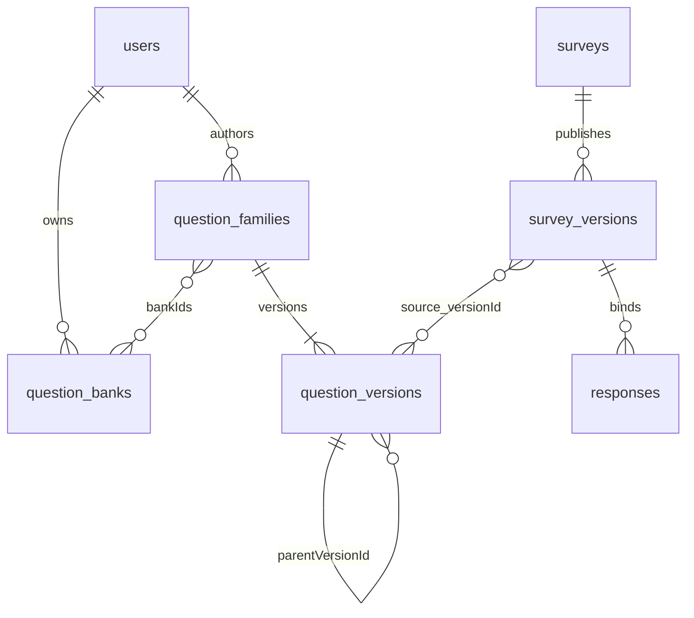

# 数据库设计（第二阶段）

实际定义以`database/schema.ts`、`apps/server/src/models.ts`、`apps/server/src/library.ts`及共享domain/library模块为准。开发库沿用`questionnaire_stage1`（库名不代表当前阶段），测试库为`questionnaire_test`。共八个集合，旧五集合保留，题库采用三个新增集合。

| 集合            | 主体及关键字段                                                                                                | 主要索引                                               |
| --------------- | ------------------------------------------------------------------------------------------------------------- | ------------------------------------------------------ |
| users           | 账号；username、usernameNormalized、passwordHash、createdAt                                                   | usernameNormalized 唯一                                |
| sessions        | 登录；userId、tokenHash、csrfToken、expiresAt                                                                 | tokenHash 唯一，expiresAt TTL，userId                  |
| surveys         | 归属、草稿、状态；ownerId、publicId、draft、activeVersionId、deadlineAt、revision、submissionGateSeq          | publicId 唯一，ownerId+updatedAt+_id                   |
| survey_versions | 发布定义；surveyId、versionNumber、sourceDraftRevision、definition                                            | surveyId+versionNumber 唯一                            |
| responses       | 一次填写；surveyId、surveyVersionId、participantKey、answers、visitedQuestionIds、status、editDraft、revision | 尝试幂等唯一、禁止重复提交条件唯一、统计及本人草稿索引 |

二期新增集合：

| 集合 | 关键字段 | 索引 |
| --- | --- | --- |
| question_banks | ownerId、name、description、revision、createdAt、updatedAt | ownerId+updatedAt |
| question_families | ownerId、latestVersionId、versionCount、revision、bankIds、sharedWithUserIds | ownerId+updatedAt、sharedWithUserIds+updatedAt、bankIds |
| question_versions | familyId、versionNumber、parentVersionId、restoredFromVersionId、content、createdBy、createdAt | familyId+versionNumber唯一 |

## 嵌入与引用

问卷定义包含有限的题目数组，每题嵌入选项、validation及logic。填写时一次取得完整定义，可整体检查条件引用和保存。二期独立题目保存于question_versions，但问卷仍嵌入所选版本的快照；填写和统计不动态解析“最新题目”，因此题库更新不改变历史含义。

题目系列表示同一问题的身份与授权，题目版本表示不可变内容，问卷内UUID表示某次使用的实例，三者不能混用。实例增加可选source={familyId,versionId}，两个ID使用24位小写十六进制字符串以复用JSON定义；独立集合内引用仍用BSON ObjectId。导入保留选项ID，生成新实例ID；跨卷统计通过来源版本找到各问卷实例ID，再匹配答案。

常用题不携带其他问卷的跳转目标。content复用统一题目结构，但order固定1、logic固定next且无规则；核心比较仅含题型、题干、说明、必答、选项及validation。保存草稿及发布均核对source存在且核心一致，不能通过修改浏览器偷改旧版本。实例跳转和顺序可独立设置。

每份答卷引用问卷与确切的发布版本，答案只保存稳定题目ID、服务器写入的题型及值，不重复保存题干。答卷数量可以增长，因此不嵌入问卷文档。历史发布版本也独立，避免问卷单文档不断膨胀。

surveys.title 是列表摘要冗余，由保存/发布流程同步；responses.surveyId 是查询和唯一限制需要的受控冗余；repeatAllowed 从可信发布设置冻结。没有独立统计集合，已提交答卷是统计事实来源。

主键与跨集合引用使用 BSON ObjectId，日期使用 BSON Date/UTC，API转换为字符串；题目、选项、规则和客户端尝试ID使用UUID。所有文档带 schemaVersion。versionNumber、revision分别表示发布版本和并发修订号。

新账号密码在应用层强制8～128字符、大写、小写及数字要求，再存Argon2id哈希；数据库不保存明文，也无法从哈希验证字符组成，因此复杂度规则由注册接口和演示数据入口统一执行。登录先判断usernameNormalized是否存在，再校验哈希；对已有账号不追加新密码规则，不改变现有数据结构。

## 填写设置与两种行为

```json
{
  "allowAnonymous": true,
  "allowMultipleSubmissions": false,
  "allowEditAfterSubmission": true
}
```

允许重复时关闭 `allowEditAfterSubmission`，每次再填插入新答卷。禁止重复时最多保留一份已提交答卷；若允许修改，则在原文档创建 `editDraft: { answers: [...] }`。保存修改仅更新该字段和revision，主answers/status不变；确认后在事务中替换主answers，清空editDraft并增加editCount，仍用同一_id。submittedAt保留首次提交，lastSubmittedAt记录最近一次确认。

相同提交请求使用 `lastSubmissionId + submissionHash` 判断重试；摘要按绑定版本、匿名选择和规范化答案计算，不包含revision和CSRF。浏览器重试不产生额外答卷。

禁止重复的数据库兜底：

```javascript
db.responses.createIndex(
  { surveyId: 1, participantKey: 1 },
  {
    unique: true,
    name: "one_submission_per_participant",
    partialFilterExpression: { status: "submitted", repeatAllowed: false },
  },
);
```

同一人的多份草稿允许存在，只有成功提交占用唯一键。修改原答卷不改变该键，因此无需删除旧答卷再插入。匿名和实名使用相同participantKey，不能切换身份展示方式绕过限制。

## 匿名和身份

participantKey为HMAC_SHA256(持久服务器密钥, surveyId:userId)，按问卷隔离。匿名答卷respondentId为null，非匿名为账号ObjectId。创建者接口排除participantKey、clientAttemptId、提交摘要和editDraft。登录仍是匿名填写的前提，不收集设备指纹或IP作为参与者身份。

HMAC标识也用于填写者访问自己答卷的权限判断及去重人数统计。它是伪匿名标识，不能承诺对拥有服务器密钥的运营者不可追溯。

## 数据库与业务校验

八个集合均设置strict/error validator。账号、日期、ObjectId、bool、状态枚举和答案BSON类型由数据库校验；匿名答卷不能包含respondentId；submitted必须有提交时间、摘要和请求ID。选择数组不允许重复。新版本(familyId,versionNumber)唯一；共享用户最多50、题库归属最多20且去重。question_versions.content的validator比问卷内题目更严格：禁止出现source、order只能为1、rules数组必须为空、默认动作只能是next，把“常用题不携带问卷上下文”从应用约定落到数据库约束。不可变语义由服务层只追加接口保证；数据库管理员直接改库不属于应用权限保证。

动态问题校验、跨集合引用归属、选项属于哪道题、跳转目标合法性在共享模块和后端完成；MongoDB不提供这些业务外键。后端拒绝客户端指定ownerId、participantKey、repeatAllowed等可信字段。

每卷最多100题、每题50选项、每题20规则、文本答案最多2000字符。定义和答案额外检查实际BSON不超过1MiB，请求体不超过2MiB。应用上限避免接近MongoDB文档大小限制。

文本答案先trim首尾空白、将CRLF/CR转为LF，再按Unicode码点计数；前端显示、请求上限和业务范围使用共享函数。输入框不使用原生maxLength截断。实际MongoDB回归验证2000个表情保存成功，2001码点直接写入被validator以121拒绝；本次修复不改变数据库schema、索引或既有数据。

## 事务和并发

发布事务插入不可变快照并设置问卷发布入口，一起成功或回滚。保存草稿与答卷使用revision条件，防止旧页面覆盖新内容。

提交事务先重放路径，然后条件写问卷的submissionGateSeq，要求published、绑定版本匹配且未截止，再确认答卷。关闭操作也写同一问卷文档，因此与提交冲突后由驱动重试并重新检查状态。条件唯一索引兜底账号的唯一提交。事务使用snapshot读关注和majority写关注，不在事务内并行操作。

submissionGateSeq仅协调准入，不用作统计数字。这种每次提交写入口文档的方案适合课程规模，有写热点限制。单节点副本集支持本地事务，不等于多节点高可用。

## 二期：系列、版本与题库关系



系列的bankIds可包含最多20个本人题库；sharedWithUserIds最多50人，授权的是系列全部版本。题库只管理分类，授权仍以题目系列为边界，不会因分类移动改变共享名单。共享接收者不维护原系列的分类，可另存为自己的系列后管理。

| 字段 | 规则与用途 |
| --- | --- |
| family.ownerId | 作者，客户端不能指定；只有作者能改共享、归属、派生或恢复原系列 |
| latestVersionId | 展示最新版本，不是问卷实时引用目标 |
| versionCount / revision | 前者是追加版本号；后者也随共享与归属变更而递增，防止并发覆盖 |
| version.familyId + versionNumber | 唯一版本身份；内容创建后无覆盖或删除接口 |
| parentVersionId | 本次修改基于的版本，可指向旧版本；另存系列时可记录外部来源 |
| restoredFromVersionId | 恢复时记录内容来自哪个旧版，普通派生为null |
| content | 合法四类题的完整核心快照，脱离原问卷的顺序与跳转上下文 |
| createdBy / createdAt | 创建者及时间审计信息 |

普通派生v1→v2后，可再从v1派生v3，v2/v3并存；恢复v1生成v4，其parent=v3、restoredFrom=v1。所有旧版本保留，原问卷仍引用旧versionId。系列插入+首版插入、后续版本插入+最新指针更新使用MongoDB事务；revision条件和唯一索引共同防止并发重复编号、部分成功。

撤销共享后，新导入及原题库读取被拒绝；已保存问卷保留使用权，可继续发布、填写，也可复制整份已有问卷。保存来源校验只对当前问卷已持有的确切版本豁免新授权检查，核心内容仍必须一致。换到其他版本须重新检查权限。取消关联生成新UUID并改写入站跳转目标，去掉source后不计入原题库统计。

## 二期：跨问卷统计

1. 找到包含所选source.versionId的survey_versions，限制为本人问卷或向题目作者明确开放汇总的问卷。
2. 将每份快照内的题目实例ID与surveyVersionId成对匹配responses；仅取status=submitted主answers，不读editDraft。
3. 单选/多选按原版本选项ID分组；数字聚合count/avg/min/max并用bucketAuto最多10组展示分布；文本仅分页返回本人问卷的原文。
4. 有效回答份数为分母，跳过、空可选题和未提交草稿不计。每卷同一版本最多使用一次，不同版本可同时使用，且分别统计；跨卷participantKey不可直接比较，不声称人数去重。

5. 整道题合计（scope=family）：先取同一familyId下与基准版本题型相同的全部版本，再按上述步骤一次聚合，$facet额外按(surveyVersionId, questionId)分组，映射回来源版本得到逐版本份数。题型不同的版本单列为未合并。选项计数先按(surveyVersionId, questionId, optionId)聚合，再按不可变版本解析历史文字，仅合并ID与文字均相同的选项；改名选项单列并标明所在版本。数字题若更改单位、题目若更改含义，需切回单版本统计；系统不会自动判断语义等价。

统计的首个$match依次给出surveyId、status、surveyVersionId，正好命中responses上(surveyId, status, surveyVersionId, submittedAt, _id)统计索引的前缀；早期实现缺少surveyId条件，只能全集合扫描，本轮已修正并用explain测试锁定。

新增settings.shareLibraryStatistics可选，缺省false；分享题目不等于分享答卷。题目作者可见其他引用问卷的存在，未授权的名称隐藏，任何其他人的问卷都不提供管理链接或完整答卷。授权仅提供问卷名称和汇总，不泄露账号、HMAC标识及外部文本原文。发布时冻结授权选择。

来源查询有surveys.draft.questions.source.versionId及survey_versions.definition.questions.source.versionId多键索引，答卷仍利用surveyVersionId/status统计索引。没有预聚合统计集合，修改原答卷后自然反映最新成功提交。

## 旧数据兼容与升级

升级只新增集合、索引和可选字段；schemaVersion=1表示各集合自身文档结构版本，不等于课程阶段。旧独立题不自动识别为同一题，不改写原五集合文档。先执行db:backup，再db:init；本轮增量初始化后与备份进行规范化Extended JSON哈希比对，旧记录无改动，结果见test-evidence/stage2-migration-results.json。备份含敏感数据，只保存在.local，尚未做恢复演练。

v2兼容旧结构，不能推断main兼容二期字段。若需并行展示两期，应分别配置数据库或将一期备份恢复到独立库，保留对应HMAC密钥；切换Git分支不会回滚数据库。本次没有覆盖、删除或回填一期数据。

## 原问卷统计及后续边界

聚合只读取submitted主答案，不读取in_progress或editDraft。同时提供提交份数、participantKey去重人数、每题到达/回答/未填/跳过数；各选项返回选择份数和去重人数。数字平均值按有效数字答卷计算，零数据为null，选项零计数补齐。重复答卷中同一人选过不同选项时，该人会出现在多个选项的人数中，因此选项人数之和可大于全题去重人数。

版本定义不修改；未来增加版本只新增survey_versions，旧答卷保留原version引用。新增题型或条件扩展schema、解释器、渲染器和统计分支。迁移使用schemaVersion，先备份后验证旧功能。第一阶段没有自动删除答卷的TTL策略。

## 数据库验收工具（npm run db:verify）

`database/verify.ts`是只读核查（仅listCollections、listIndexes、find、countDocuments），`scripts/verify.ts`为命令行入口：默认检查.env中的开发库，`--test`检查questionnaire_test，`--baseline latest|目录`与db:backup产生的升级前备份比对。结果逐项打印PASS/FAIL/WARN，并写出只含文档ID的JSON报告（不含答案、用户名或密码哈希）。tests/verify.test.ts用正常接口造数后要求零错误，再逐项人为破坏验证每项检查确能发现问题。

| 检查 | 内容 | 级别 |
| --- | --- | --- |
| collections | 八集合存在；已部署validator与schema.ts逐字段一致；strict/error | 错误 |
| indexes | 18个索引齐全，含唯一、TTL及“一人一份”部分唯一索引条件 | 错误 |
| documents | 每个集合用`{$nor:[validator]}`查出不满足当前validator的旧文档 | 错误 |
| users | usernameNormalized与username小写一致 | 错误 |
| surveys / survey_versions | 状态与draft/activeVersionId互斥关系、发布入口归属、title冗余同步、closedAt、快照创建者 | 错误 |
| definitions | 草稿与发布定义能被当前业务规则重新解析 | 提示 |
| responses | 答卷问卷/版本归属一致、答案题目存在且题型一致、repeatAllowed与冻结设置一致、匿名约束、editDraft只在已提交答卷 | 错误 |
| question_banks / question_families | 所有者存在；版本号1..n连续、versionCount、latest指针为最大版本、共享用户存在且不含作者、归属题库属于作者 | 错误 |
| question_versions | 无孤立版本、创建者为作者、父版本存在且更早、恢复来源同系列且内容一致、内容可规范化且核心不变 | 错误 |
| sources | 问卷草稿及发布快照中的source指向存在版本、family匹配、核心内容一致、同卷不重复 | 错误 |
| baseline | 与升级前备份比对：发布快照逐字节不变，旧用户/问卷/发布版本/答卷无缺失 | 错误 |
| baseline_changes | 备份后因正常填写、修改、关闭而变化的旧文档，供人工核对 | 提示 |
