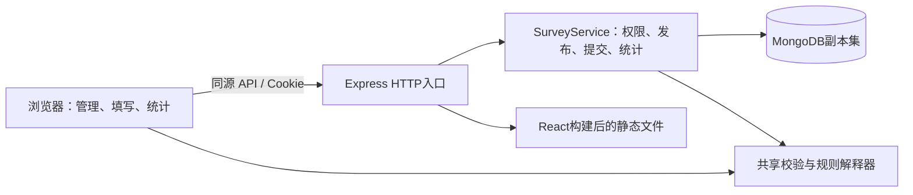
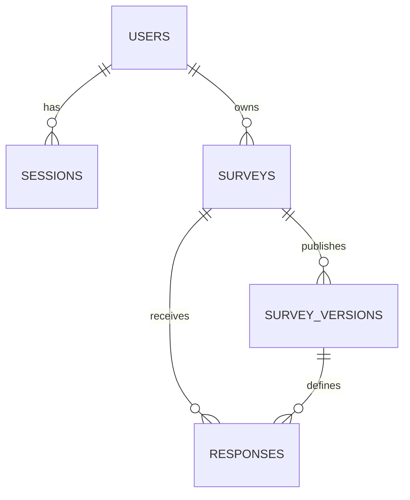
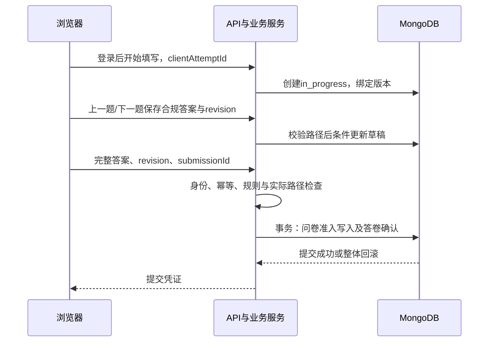

代码仓库：https://github.com/Mediocrity-919/database-course-project

# 基于 MongoDB 的问卷系统——第一阶段项目完成报告

姓名：彭欣  
项目名称：问笺（Survey Studio）  
报告日期：2026年10月22日  
阶段一代码基线：main / db9388e  
需求依据：项目根目录《大作业一.docx》的第一阶段及初始用户需求  
实现范围：本地前后端、MongoDB结构、自动测试与Markdown交付材料。公网部署尚未执行。

## 1. 项目目标与完成范围

本项目实现一个简化的在线问卷系统。注册用户能够设计、发布和分享问卷，填写者登录后回答问题，系统根据配置执行校验和条件跳转，并根据已提交答卷计算统计结果。

项目重点是MongoDB文档建模、后端一致性、可配置跳转和可验证的AI开发过程。数据库使用MongoDB，未使用关系数据库或现成问卷系统框架。React、Express、Zod、二维码库等仅提供通用基础能力，问卷定义、发布版本、填写、校验、跳转和统计均由项目代码实现。

| 初始要求                                       | 实现与验收情况                                                 |
| ---------------------------------------------- | -------------------------------------------------------------- |
| 注册、登录，管理自己的问卷与统计               | 已实现；用户名唯一、会话鉴权和ownerId权限隔离                  |
| 标题、说明、匿名设置、列表、发布、截止和关闭   | 已实现；发布生成不可变定义，状态及截止由服务器检查             |
| 每份问卷有可分享URL，填写者登录                | 已实现/survey/:publicId及登录回跳；同时生成同URL二维码         |
| 单选、多选、文字和数字填空                     | 内部分为四种题型；支持必答、选择数量、文本长度、数值范围和整数 |
| 根据单选、多选、数字配置跳转                   | 已实现规则数据、first_match优先级和路径重放                    |
| 保存填写、多人并发、匿名、允许时重复填写       | 已实现；合规答案逐题保存，未提交记录不计统计                   |
| 整卷及单题统计、选择人数、填空内容、数字平均值 | 已实现MongoDB聚合及分页，同时区分提交份数和去重人数            |

经需求讨论，增加了两种互斥的填写策略：禁止重复时可允许修改原答卷；允许重复时每次生成新答卷，不修改旧答卷。二维码、密码复杂度及原答卷修改是项目追加能力，不替代原文基本要求。

第一阶段采用明确边界：发布后锁定题目和策略；允许修改截止时间、关闭或复制成新问卷；跳转只允许向后或提前结束；匿名填写仍须登录。原文没有要求云服务器、指定前端组件库、文件上传或Excel导出。

## 2. 系统架构与环境



前端使用React、TypeScript、Vite和React Router；界面采用原生控件、自定义CSS、图标与CSS条形图。后端使用Node.js、Express、官方MongoDB驱动、Zod和Argon2id。代码分为apps/web、apps/server、packages/shared、database及tests，依赖由单一根package.json和package-lock.json管理，没有配置npm workspaces。

本机实测Node.js 24.14.0、npm 11.9.0、MongoDB 8.3.11。MongoDB以单节点副本集survey-rs运行于127.0.0.1:27018，数据目录为.local/mongo-rs。开发库为questionnaire_stage1，测试库为questionnaire_test。副本集是发布与提交事务的运行前提；单节点配置不表示多节点高可用。

开发模式由Vite在5173端口代理/api/v1到3000端口。构建后由Express在3000端口同时提供前端和API。API路由优先于静态文件及SPA回退，不存在的API返回JSON 404。

首次运行步骤如下，均在项目根目录执行：

```powershell
npm.cmd ci
npm.cmd run setup
npm.cmd run db:start
npm.cmd run db:init
npm.cmd run build
npm.cmd start
```

打开http://localhost:3000并自行注册账号。setup仅在.env不存在时生成配置和持久密钥，已有文件不覆盖。MongoDB路径、开发模式、演示数据和测试前提见[README](../README.md)。当前配置是本机开发配置，公网部署需要另行配置可达入口。

## 3. MongoDB数据库设计

### 3.1 集合边界与设计理由



所有持久化业务数据存入以下五个集合。浏览器状态只服务于交互，不以localStorage代替业务数据库。

| 集合            | 一份文档的含义                 | 主要字段及BSON类型                                                                                                                                                       |
| --------------- | ------------------------------ | ------------------------------------------------------------------------------------------------------------------------------------------------------------------------ |
| users           | 一个账号                       | _id:ObjectId；username、usernameNormalized、passwordHash:String；createdAt、updatedAt:Date                                                                               |
| sessions        | 一次登录会话                   | _id、userId:ObjectId；tokenHash、csrfToken:String；createdAt、expiresAt:Date                                                                                             |
| surveys         | 问卷入口、归属、草稿及收集状态 | ownerId:ObjectId；publicId、title、status:String；draft:Object/null；activeVersionId:ObjectId/null；deadlineAt:Date/null；revision、submissionGateSeq:Number             |
| survey_versions | 一次发布的不可变定义           | surveyId、createdBy:ObjectId；versionNumber、sourceDraftRevision:Number；definition:Object；publishedAt:Date                                                             |
| responses       | 一次填写尝试及其最终提交       | surveyId、surveyVersionId:ObjectId；participantKey、clientAttemptId、status:String；answers、visitedQuestionIds:Array；editDraft:Object/null；revision、editCount:Number |

所有集合文档均包含schemaVersion=1。集合之间使用ObjectId引用；题目、选项、规则、填写尝试请求和提交请求使用UUID字符串；时间存储为BSON Date，接口使用ISO时间字符串。

**问卷定义采用嵌入。** 一份问卷的题目、选项、校验和跳转规则通常一起读取和验证，而且数量有明确上限，故嵌入同一definition。第一阶段没有独立题库需求，不机械拆成题目、选项和规则等大量集合再连接。

**答卷采用引用。** 答卷数量会持续增长且多人同时写入，因此每次填写一个responses文档，引用问卷和发布版本，不使用surveys.responses大数组。这样避免问卷文档随收集次数无限膨胀。

**管理入口与版本分离。** 问卷截止时间和收集状态可变，已发布题目应固定。surveys保存管理入口，survey_versions保存定义；答卷绑定确切版本，防止旧答案因题目修改失去解释依据。第一阶段每卷仅发布一次，版本模型为第二阶段扩展保留结构基础。

**采用有限冗余。** surveys.title服务列表查询；responses.surveyId服务统计和重复限制；questionType及repeatAllowed由服务器从版本写入，服务类型校验、聚合和条件索引。每份答卷不复制题干和选项文字，也不额外维护容易与原始答案不一致的统计集合。

关系数据库也能实现此业务，但作业明确要求MongoDB。本模型按读取方式、生命周期和增长边界组织文档，保留独立实体的引用，将有界且共同使用的数据嵌入，适合MongoDB文档结构及多态答案。灵活结构并不意味着取消schema。

### 3.2 问卷定义与答案结构

definition包括title、description、settings及questions。settings包含：

```json
{
  "allowAnonymous": true,
  "allowMultipleSubmissions": false,
  "allowEditAfterSubmission": true
}
```

题目结构如下。为可读性使用q1、q3、oA等短标识；运行时均为UUID。

```json
{
  "id": "q1",
  "order": 1,
  "type": "single_choice",
  "title": "是否参加过活动？",
  "description": "",
  "required": true,
  "options": [
    { "id": "oA", "label": "参加过", "order": 1 },
    { "id": "oB", "label": "没有", "order": 2 }
  ],
  "validation": {},
  "logic": {
    "matchMode": "first_match",
    "rules": [
      {
        "id": "r1",
        "priority": 1,
        "when": { "operator": "eq", "value": "oB" },
        "then": { "action": "goto", "targetQuestionId": "q3" }
      }
    ],
    "defaultAction": { "action": "next" }
  }
}
```

answers只保存实际提供的有效答案，每项包含questionId、服务器补充的questionType及value。单选value为选项ID，多选为不重复的ID数组，文本为String，数字为数值。可选空题不写入answers，但写入visitedQuestionIds；被跳过的题两处都不写入。

题目顺序order不用于引用。排序保持题目UUID，复制问卷重建题目、选项及规则UUID并重写目标引用。schemaVersion是结构版本，versionNumber是发布版本，revision是并发修订号，三者用途不同。

### 3.3 索引设计

| 集合            | 索引键                                                      | 作用                           |
| --------------- | ----------------------------------------------------------- | ------------------------------ |
| users           | usernameNormalized，唯一                                    | 大小写规范化后的用户名不能重复 |
| sessions        | tokenHash，唯一                                             | 查找会话且不保存原登录令牌     |
| sessions        | expiresAt，TTL=0；userId                                    | 清理到期会话、按用户查询会话   |
| surveys         | publicId，唯一                                              | 稳定的分享标识                 |
| surveys         | ownerId、updatedAt倒序、_id倒序                             | 本人问卷列表及游标分页         |
| survey_versions | surveyId、versionNumber，唯一                               | 同问卷版本号唯一               |
| responses       | surveyId、participantKey、clientAttemptId，唯一             | 开始填写请求幂等               |
| responses       | surveyId、participantKey，条件唯一                          | 禁止重复模式最多一份已提交答卷 |
| responses       | surveyId、status、surveyVersionId、submittedAt倒序、_id倒序 | 统计筛选与答卷分页             |
| responses       | surveyId、participantKey、status、updatedAt倒序             | 本人草稿/答卷查询              |

禁止重复的关键索引如下：

```javascript
db.responses.createIndex(
  { surveyId: 1, participantKey: 1 },
  {
    name: "one_submission_per_participant",
    unique: true,
    partialFilterExpression: {
      status: "submitted",
      repeatAllowed: false,
    },
  },
);
```

条件索引允许同一人保留多个未提交草稿，只有正式提交且禁止重复时占用唯一键。repeatAllowed来自可信发布版本，客户端无法选择该值绕过限制。不能仅靠“提交前查询一次”保证并发唯一性。

### 3.4 数据库约束与身份隔离

database/schema.ts实际建立五集合的strict/error validator，检查必要字段、BSON类型、状态、答案类型和数组形状。匿名答卷的respondentId必须为null，实名答卷必须为ObjectId；submitted必须具有提交时间、摘要和请求ID；多选数组不得重复。

每卷最多100题、每题50选项及20条规则，文本答案最多2000码点。应用对定义和答案执行BSON大小检查，上限1MiB；HTTP JSON请求上限2MiB。跨集合归属、选项属于哪道题、动态范围和跳转合法性由后端负责，MongoDB不自动提供这些业务外键。

密码只存Argon2id哈希。会话原令牌保存在HttpOnly Cookie，数据库存tokenHash；TTL负责清理，鉴权仍检查expiresAt，不能等待TTL准点删除。

匿名的内部标识为HMAC_SHA256(持久密钥, surveyId:userId)。同账号在同问卷的匿名与实名填写得到相同participantKey，避免切换展示身份绕过限制。创建者响应移除participantKey、尝试ID、提交摘要和修改草稿。该方案是对创建者隐藏身份的伪匿名，不承诺对掌握服务器密钥的运营者不可追溯。

## 4. 后端流程、事务与并发

### 4.1 注册、登录和权限

注册统一去除用户名首尾空白并转小写查重，MongoDB唯一索引最终兜底。新密码须8～128个字符，并同时包含ASCII大写、小写及数字；前后端共享规则并逐项提示缺少内容。密码不作trim处理。

登录先查用户名：不存在返回USER_NOT_FOUND并引导注册；存在但密码错误返回PASSWORD_INCORRECT。已有账号不因新注册复杂度规则被锁定。管理接口按当前会话userId匹配ownerId；填写接口通过participantKey确认答卷本人权限。修改请求检查Origin及CSRF，身份相关入口限流。

### 4.2 发布事务

草稿保存以revision作条件，成功后递增；旧revision返回409。发布事务检查归属、草稿revision、定义及截止时间，插入survey_versions，并将surveys改为published、绑定版本、清空draft。两个写入一起成功或回滚。

sourceDraftRevision用于识别同一草稿版本的发布重试，避免双击产生重复发布。发布后没有更新定义的业务接口，原版本保持不变。

### 4.3 填写和提交



最终提交重新读取绑定快照并重放路径，拒绝不存在、重复或不可达的答案。事务条件写surveys.submissionGateSeq，要求问卷仍开放、版本匹配且未截止，然后确认responses。

关闭及截止修改也写同一问卷文档，与提交竞争时触发数据库写冲突及事务重试，重试后重新检查准入。acceptedAt记录准入时间；已准入事务可以稍后完成，准入前已关闭或截止则拒绝。事务使用snapshot读关注与majority写关注。

submissionId和规范化答案摘要处理提交重试：同ID同内容返回原凭证，同ID换内容返回冲突。已成功请求即使问卷随后关闭仍能重试确认。浏览器遇到提交结果不确定时锁定原请求并允许重试，不先发另一条草稿保存。

每次提交写问卷入口有课程规模下可接受的写热点，10人并发测试不能推导为大规模吞吐保证。

### 4.4 原答卷修改与重复填写

禁止重复且允许修改时，在同一responses文档创建editDraft。保存修改只更新editDraft和revision，主answers及submitted状态保持，统计仍读取原答案。确认修改时在事务中替换主答案，清空editDraft，增加editCount，保留_id及首次submittedAt，更新lastSubmittedAt。因此份数不增加。

允许重复时每次使用新的clientAttemptId创建新答卷；原答卷不覆盖，allowEditAfterSubmission须关闭。同人两次填写贡献两份答卷和一个去重填写者。

## 5. 跳转与校验设计

### 5.1 数据驱动的条件跳转

| 题型 | 条件                                   |
| ---- | -------------------------------------- |
| 单选 | eq，等于某选项ID                       |
| 多选 | contains_any、contains_all、equals_set |
| 数字 | eq、gt、gte、lt、lte、between          |
| 文本 | 不配置内容条件，使用默认动作           |

动作只有next、goto后续题、end。规则按priority升序，第一条命中即执行；否则执行defaultAction。between为闭区间，多选按集合比较而非数组顺序。规则保存在MongoDB定义中，不写死某份问卷的业务分支。

保存/发布检查题目及选项ID唯一、校验范围自洽、规则操作符与题型相容、引用有效、优先级唯一及跳转向后。运行时进一步限制重复访问，防止循环。当前没有全图不可达题静态诊断或数字区间重叠提示；重叠条件按既定优先级处理。

服务端重算路径，实际经过的必答题必须有值，被跳过的必答题不阻止提交。前端返回前题改变分支时清除不再可达的旧答案；后端拒绝恶意保留的隐藏答案。

### 5.2 三层校验

1. 前端使用共享规则，显示范围和错误，减少无效请求。
2. 后端校验请求、权限、版本、动态答案、实际路径和收集状态，是最终业务边界。
3. MongoDB validator及索引保证基本结构、BSON类型和唯一性，阻止错误持久化。

多选恰好N项表示minSelections=maxSelections=N。可选题允许完全留空，但一旦填写必须合规。数字0是合法值，空输入不转换为0；数字必须有限，integerOnly要求安全整数。年龄可配置0～120整数；手机号示例13800138000已经验证。实际手机号若要保留前导零、区号或加号，后续应设计文本格式题。

### 5.3 文本长度缺陷及修复

验收发现共享业务函数按Unicode码点计数，而HTML maxLength和原请求schema按UTF-16长度限制。两个表情可能被输入框截断，1001个表情也会在2000字符接口上限下被错误拒绝。

修复后，normalizeTextAnswer统一trim首尾空白并将CRLF/CR转换为LF，textAnswerLength按Array.from规范化文本的长度计数。前端显示计数，请求schema检查2000码点全局上限，业务层检查每题min/max，入库保存规范化值。输入框移除原生maxLength，保留超限内容并提示用户修正，避免静默截断及干扰中文输入。

😀、𠀀各计1码点，组合表情和组合重音可能包含多个码点；这里不使用视觉字形簇计数。规则仅作用于文本答案，未同时改变用户名、密码和标题的长度约定。已有MongoDB maxLength约束经真实测试与该口径一致，无须修改数据库结构或迁移旧数据。

## 6. 前端页面与操作流程

界面使用浅灰绿背景、白色卡片与深绿色主按钮，管理页面强调结构，填写页面一次聚焦一道题。主要页面如下：

| 页面           | 路径                                          | 作用                                  |
| -------------- | --------------------------------------------- | ------------------------------------- |
| 登录/注册      | /login、/register                             | 用户名提示、密码缺项清单及登录回跳    |
| 工作台         | /dashboard                                    | 本人问卷列表、状态、管理入口          |
| 新建/编辑/预览 | /new、/surveys/:id/edit、/surveys/:id/preview | 题目、校验和规则配置；预览不产生答卷  |
| 分享           | /surveys/:id/share                            | 复制URL、生成及下载二维码             |
| 填写           | /survey/:publicId及其attempt子路径            | 简介、登录、匿名选择、逐题填写和恢复  |
| 完成           | /survey/:publicId/complete/:attemptId         | 凭证、按策略修改或再填                |
| 统计           | /surveys/:id/results                          | 整体与单题统计、选项图、文本/数字分页 |

编辑器保存请求发出后若继续编辑，响应只同步revision，不覆盖新内容；仍提示未保存，再保存后才能发布。恢复填写时等待本人草稿加载，显示并锁定该草稿原有匿名设置。

上一题和下一题都会先保存有效答案。未满足长度、范围或数量要求的输入仅暂存页面并提示，修正前刷新可能丢失该部分；“保存每次填写”实现为尝试文档及合规逐题持久化，不是每个按键自动写库。

### 6.1 API交互与权限摘要

所有接口统一使用/api/v1前缀，答案、定义和错误使用JSON。登录成功设置HttpOnly会话Cookie，并返回csrfToken；修改请求同时检查登录身份、可信Origin及X-CSRF-Token，注册与登录入口执行来源检查及限流。

| 方法及路径 | 权限 | 主要输入和结果 |
| --- | --- | --- |
| POST /auth/register、/auth/login | 公开 | username、password；创建账号或返回会话与CSRF令牌 |
| GET /surveys；POST /surveys | 登录 | 查询本人列表；创建具有publicId的问卷草稿 |
| PUT /surveys/:id/draft | 创建者 | revision、definition、deadlineAt；返回新revision |
| POST /surveys/:id/publish | 创建者 | revision；事务生成不可变发布快照 |
| POST /public/surveys/:publicId/attempts | 登录 | clientAttemptId、isAnonymous；创建或幂等返回填写尝试 |
| PUT /attempts/:id/answers | 填写本人 | revision、answers；验证后保存有效答案 |
| POST /attempts/:id/submit | 填写本人 | revision、answers、submissionId；事务返回提交凭证 |
| POST /attempts/:id/edit | 填写本人 | revision；策略允许时进入原答卷修改草稿 |
| GET /surveys/:id/stats | 创建者 | 查询已提交数据的整卷及单题统计 |

非法输入返回422，未登录返回401，越权管理请求按资源不存在返回404，revision或重复限制冲突返回409，问卷关闭或截止返回410。服务器不采信客户端指定的ownerId、questionType或repeatAllowed。完整路由、请求示例及错误码见[API说明](api.md)。

## 7. 统计口径与实现

聚合只匹配指定问卷、版本且status=submitted的答卷，不读取in_progress或editDraft。使用$facet、$unwind、$group、$addToSet及$avg，直接从事实数据计算结果。

| 指标                         | 口径                                 |
| ---------------------------- | ------------------------------------ |
| totalSubmissions             | 已提交答卷份数                       |
| uniqueRespondents            | participantKey去重人数               |
| arrivedCount                 | 路径经过该题的答卷数                 |
| answeredCount                | 该题具有有效答案的答卷数             |
| skippedCount                 | 总提交份数减到达数                   |
| unansweredCount              | 到达数减回答数                       |
| 选项count及uniqueRespondents | 选择该项的份数及去重人数             |
| average                      | 有效数字答案的算术平均值，无值为null |

重复填写时同一人可在不同答卷选择不同选项，因此各选项去重人数相加可能超过全题人数。数字平均值按有效答卷计算，不是先按人合并。空数据返回0计数、null平均值，未被选择的选项仍展示。

单题内容接口每页20条并返回是否有下一页。专项检查21份答案得到20+1条，无遗漏或重复；数值1～21平均为11，提交份数21、去重人数1。

固定统计回归中，4份已提交答卷、1份草稿，单选A=3/B=1，多选x=1/y=2/z=0，数字平均值15；草稿的数值100不参与计算。测试步骤和固定输入见[测试用例](test-cases.md)。

## 8. 测试与实际结果

### 8.1 方法和环境隔离

使用Vitest测试共享规则、Supertest访问真实Express接口及MongoDB、Playwright驱动Chrome。生产构建后另运行HTTP冒烟。所有测试写入questionnaire_test，测试入口拒绝其他数据库名；不得与依赖同一测试库的其他测试进程同时运行。开发数据没有作为清理对象。

2026年10月22日提交前重新执行完整验收，结果如下；2026年10月21日完成的局域网HTTP及微信兼容修复和文本边界等既有用例均包含在内。浏览器本次使用当前局域网入口http://192.168.1.101:3010，仍只访问questionnaire_test。

| 检查                     | 结果                                         | 证据                                                  |
| ------------------------ | -------------------------------------------- | ----------------------------------------------------- |
| API及MongoDB集成         | 36通过                                       | tests/api.test.ts                                     |
| 账号共享规则及API        | 19通过                                       | tests/auth.test.ts                                    |
| 定义、校验及跳转单元测试 | 29通过                                       | tests/domain.test.ts                                  |
| 填写进度规则             | 6通过                                        | tests/progress.test.ts                                |
| UUID浏览器能力兼容       | 4通过                                        | tests/uuid.test.ts                                    |
| 单元/API合计             | 94通过，0失败                                | [Vitest JSON](test-evidence/submission-unit-results.json)    |
| Chrome浏览器流程         | 19通过，0失败、0重试后通过；真实LAN HTTP入口 | [Playwright JSON](test-evidence/submission-browser-results.json) |
| TypeScript及生产构建     | 通过                                         | npm run build实际输出                                 |
| HTTP冒烟                 | 通过                                         | npm run smoke实际输出                                 |
| 390×844移动视口          | 字符计数提示可见，无横向溢出                 | 浏览器断言及实际截图检查                              |

新增7项单元/API和3条浏览器回归覆盖：两字符表情输入、1001/2000码点、2001码点拒绝、首尾空白及换行规范化、草稿恢复、最终提交、数据库直接写入兜底。2001码点被拒绝后没有产生半提交；有效内容写入后可原样读回。

既有用例还覆盖创建、添加四类题、非法定义、跳转、权限隔离、重复策略、原答卷修改、10用户并发、关闭竞争、事务回滚、统计、二维码解码及响应丢失重试。网络异常测试由浏览器拦截模拟，不称为真实公网断网测试。

复现命令：

```powershell
npm.cmd test
npm.cmd run build
npm.cmd run test:e2e
npm.cmd run smoke
```

详细结果与历史修复记录见[测试结果](test-results.md)。本次完整回归已重新执行；首次启动验收时本机MongoDB未运行，按README启动项目副本集后重新运行，最终94项与19条均全部通过，不将未实际执行或跳过的轮次计为通过。之前专项检查的多选/数字持久化跳转、手机号和21条分页结果另有记录，不混入上述94项计数。新增4项UUID测试及1条手机完整流程覆盖HTTP缺少randomUUID/clipboard时的全部创建、填写和修改路径。微信UA与触控由Chrome模拟，没有直接运行iPhone微信或WebKit；用户已报告真实微信可连接，但修复后真机效果仍须重新验证。

2026-10-21微信问题复现：点击添加时抛出crypto.randomUUID is not a function。共享uuid.ts改为原生可用则用原生、否则getRandomValues构造UUID v4，统一替换题目、选项、规则、尝试和提交ID；复制按钮在受限环境改为选中链接并提示长按复制，移动提示不再指向“左侧”。此前仅用127.0.0.1完整测试并检查LAN页面加载，遗漏了普通HTTP的API限制；测试入口现可通过PLAYWRIGHT_TEST_ORIGIN切换真实LAN。详见[兼容性核查](browser-compat-audit.md)。

### 8.2 尚未验证的范围

尚未部署Cloudflare、验证实体手机移动网络扫码、执行全新机器安装、长期负载测试或云端备份恢复。浏览器二维码解码正确不等同公网可访问，10用户并发也不是生产容量证明。当前证据支持本地功能验收，不宣称完成所有部署环境测试。

### 8.3 六类必测内容的步骤、输入与输出

下表摘录仓库中已有自动化用例，便于独立阅读报告；完整案例及复现条件见[测试用例](test-cases.md)。

| 类别 | 步骤与输入 | 预期及已验证结果 |
| --- | --- | --- |
| 创建问卷 | 注册登录A，POST /surveys并读取详情；B读取同一问卷 | A得到201、draft及唯一publicId；B得到404 |
| 添加题目 | 保存单选、多选、文本、数字四类题及规则，刷新读取 | 四类定义完整保留；旧revision保存返回409 |
| 条件跳转 | 单选跳过必答题；多选命中多条规则；数字输入17、18、60 | 单选走目标；多选按最低priority命中；between包含18和60 |
| 答案校验 | 整数范围0～120输入0、120、-1、121、1.5；文本2000与2001码点 | 合法边界通过；非法答案被拒绝；2001码点不会被静默截断 |
| 保存与提交 | 开始填写、保存、恢复、确认；重放同submissionId；关闭后新提交 | 草稿可恢复；重试返回同一凭证且份数不增；新提交410 |
| 统计结果 | 准备4份submitted和1份草稿；读取统计 | 4份有效，草稿不计；单选A=3/B=1，多选1/2/0，数字平均15 |

原答卷修改专项输入为首次数字2、修改草稿8：确认前平均值仍为2，确认后为8，答卷ID、份数和人数不变。允许重复专项由同一账号提交10和20：得到两个不同答卷ID、2份/1人、平均15。并发专项还覆盖10个账号同时提交及关闭竞争。

## 9. 遇到的问题及解决方法

| 实际问题                                   | 原因及处理                                                        |
| ------------------------------------------ | ----------------------------------------------------------------- |
| npm全局缓存目录写入失败                    | 改用项目.local/npm-cache，不修改系统目录权限                      |
| TypeScript测试参数类型不匹配、早期样式笔误 | 修正类型和CSS，再执行类型检查与构建                               |
| Windows浏览器测试子进程收尾停留            | scripts/browser.ts显式启动、检查和关闭测试服务，测试正常退出      |
| 恢复草稿匿名选择与原记录不一致             | 等待本人记录，绑定并锁定原身份选择                                |
| 保存响应覆盖等待期间的新编辑               | 编辑序号识别迟到响应，保留新内容，只更新revision                  |
| 后续无效答案阻塞返回前题后的导航           | 只保存有效可达前缀，暂留未完成输入并提示                          |
| 提交成功但响应丢失后重试失败               | 固定原submissionId、revision及答案；直接幂等确认，不先保存草稿    |
| 上一题未持久化当前有效答案                 | 导航前等待保存；保存响应丢失时回读核对                            |
| 文本Unicode计数跨层不一致                  | 统一规范化及码点计数，移除输入截断，补足真实API/数据库/浏览器测试 |
| 计划保留开发前描述、缺正式报告             | 更新实际技术选型、目录、命令和状态，补齐本报告及验收记录          |

以上问题均来自实际开发或验收，不虚构未发生的人工排错过程。功能修复由Codex完成，相关测试已执行。

## 10. AI使用过程与责任说明

### 10.1 工具、提示与产出

开发使用Codex，通过阅读本地需求、生成和修改代码、运行命令及浏览器测试协助完成。具体使用日志见[ai-log.md](ai-log.md)。

| 实际任务/提示                                        | AI产出及后续处理                                       |
| ---------------------------------------------------- | ------------------------------------------------------ |
| 阅读作业，重点设计数据库及前后端执行流程，只给plan   | 生成五集合、版本、规则、统计及部署方案；未把计划当实现 |
| 讨论禁止重复时修改原答案、允许重复时新增答卷         | 明确两种互斥模式，完善editDraft与统计口径              |
| 按plan实现数据库和代码，执行测试与冒烟               | 生成前后端、schema、初始化脚本、测试及说明             |
| 登录先检查用户名，密码要求大写、小写和数字并提示缺项 | 调整账号接口与页面，补充账号测试                       |
| 验收代码，修复问题后重新验收                         | 发现并修复草稿身份、保存竞争、导航、提交重试等问题     |
| 详细检查第一阶段遗漏                                 | 发现报告缺失、过时文档及Unicode跨层边界                |
| 先修复文本边界，再写Markdown报告并更新plan/README    | 完成本次共享规则修复、90/18项复验及交付材料整理        |

### 10.2 AI的贡献与错误

AI完成数据结构建议、主要代码、回归测试和文档整理，并通过实际运行验证。AI早期产出存在缺陷：部分异步页面状态处理不完整，文本单元测试虽按码点通过，却没有发现浏览器和接口仍使用UTF-16限制；计划也出现未同步实现状态的问题。

处理方式是从真实使用路径复现问题，补充跨层测试后修复，而不是仅凭已有通过数量判断系统无缺陷。本次将Unicode问题纳入固定测试，避免同类回归。

### 10.3 提交者的设计决策与人工修改情况

提交者明确提出并确认了禁止重复时修改原答卷、重复填写生成新答卷、URL与二维码分享、用户名不存在引导注册以及密码缺项提示等需求，并持续要求验收和修正。这些属于需求及设计决策。

截至本报告，没有提交者在生成后手工修改源代码的已知记录；实际代码修改由Codex执行，不能将其记为人工独立编写。提交者后续应依据实际阅读、调试和修改补充记录，并能够解释集合边界、唯一索引、路径重放、事务和统计口径。项目在2026-10-22整理首个Git提交，先前过程依据AI日志和测试证据记录，不虚构逐步提交历史。

## 11. 分享、交付与第二阶段准备

### 11.1 URL、二维码及部署状态

数据库保存稳定publicId，完整URL由PUBLIC_BASE_URL和/survey/:publicId生成，二维码编码同一URL。更换部署域名无需重写问卷ID，但旧二维码中的域名不会自动变化。

2026-10-21补充：按要求将品牌改为“问笺”，配置HOST=0.0.0.0及PUBLIC_BASE_URL=http://172.25.23.29:3000，允许同一可互访局域网的设备访问。原有账号、问卷及数据库密钥保留，MongoDB仍只监听回环地址。已在本机通过无线IPv4完成页面、API及预检检查，实体手机仍待实测。2026-10-22验收时无线IPv4已变为192.168.1.101，浏览器测试使用相应的3010测试入口；历史局域网IP不是永久访问地址，日常跨设备运行应按当前网络更新入口配置。云服务器不是第一阶段强制要求；Cloudflare方案保留为未来跨网络选项，尚未部署。详见[部署说明](deployment.md)及[plan第11节](../plan.md#11-cloudflare-接入与后续部署)。

### 11.2 提交材料对应

| 原文提交项                         | 项目材料                                                           |
| ---------------------------------- | ------------------------------------------------------------------ |
| 可运行前后端、MongoDB schema、配置 | apps、packages、database、scripts、package-lock.json、.env.example |
| 系统说明                           | README.md、本报告第1～2及6节                                       |
| 数据库设计                         | 本报告第3～4节、database-design.md                                 |
| API说明                            | api.md                                                             |
| 关键逻辑                           | 本报告第4～7节、key-logic.md                                       |
| 测试步骤、输入、输出、结果         | test-cases.md、test-results.md、test-evidence                      |
| 完整项目报告                       | 本文件                                                             |
| 真实AI日志和总结                   | ai-log.md、本报告第10节                                            |

提交代码应包含锁文件与配置模板，不包含.env真实密钥、node_modules或正在使用的.local数据库文件。数据库如需留档，应使用独立逻辑备份并保管恢复所需密钥，不能把复制运行中的数据目录当作已验证备份。

### 11.3 第二阶段兼容性计划

当前保留schemaVersion、发布版本引用、稳定题目ID及旧答卷。未来变更应在现有集合和代码上扩展：新增字段提供兼容默认值；新增题型同时扩展schema、校验、渲染和统计；新发布版本新增快照，不改写旧定义；策略变更先明确旧数据及条件索引如何兼容。

本次首个Git提交纳入阶段一代码、本报告与测试证据，基线以实际提交号为准；数据库逻辑备份及恢复演练尚未执行。本机.env和.local数据保留并排除在Git外。第二阶段实施迁移前备份，迁移后运行第一阶段回归并检查旧数据引用，说明设计变化和兼容性，不丢弃当前系统重做。
