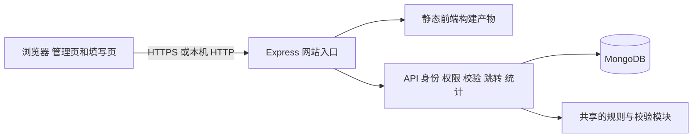
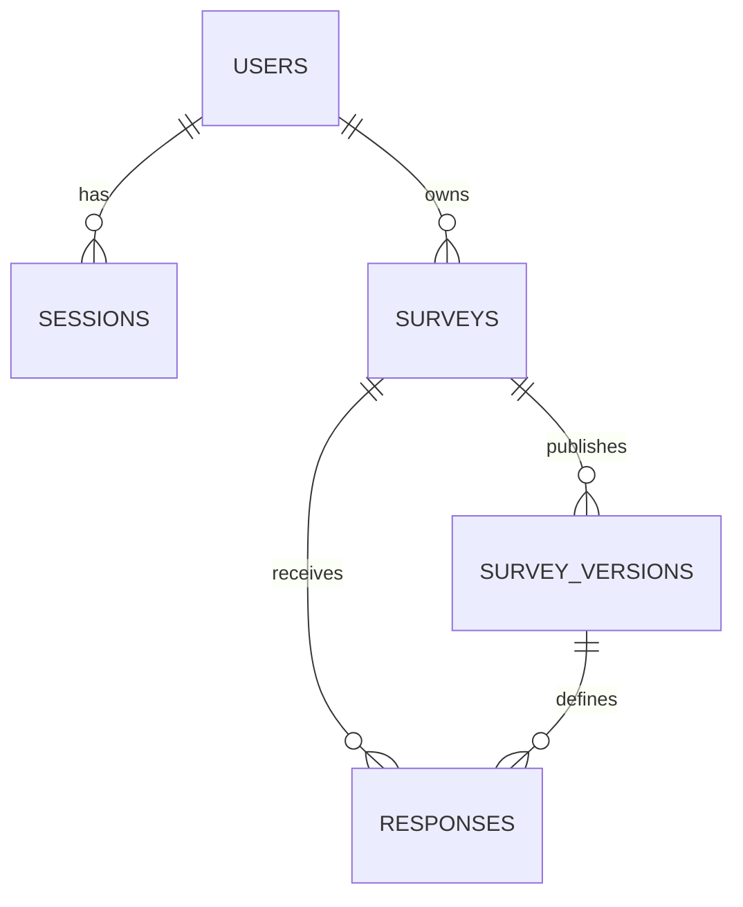
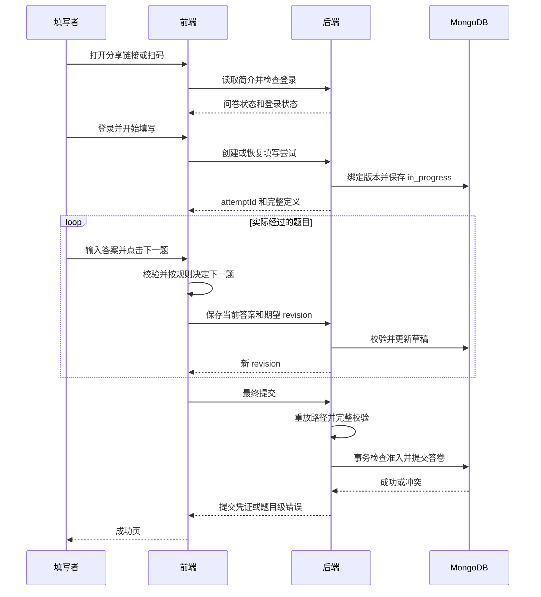

# 基于 MongoDB 的问卷系统第一阶段实施计划

2026-10-21运行配置补充：网站中文品牌已改为“问笺”；当前启用局域网入口http://172.25.23.29:3000，HOST=0.0.0.0，保留localhost访问及原数据库。已检查WLAN IPv4页面/API并通过两条浏览器流程，实体手机待实测。下文环境模板仍保留可移植的本机默认值，当前电脑的实际局域网设置见README及docs/deployment.md；公网部署状态仍为未执行。

本文依据当前目录中的《大作业一.docx》全文及评分表制定，更新日期为2026年10月20日。本文保留设计理由并同步当前实现，未实施的部署和扩展事项单独标明。运行方法见[README](README.md)，正式完成报告见[report-stage1.md](docs/report-stage1.md)，实际校验与索引见database/schema.ts。

已实现 **React + TypeScript + Vite前端、Node.js + Express + TypeScript后端、MongoDB数据库**。数据库采用五个集合：`users`、`sessions`、`surveys`、`survey_versions`、`responses`。题目、选项、校验和跳转规则嵌入问卷定义，每份答卷独立存储，发布时保存不可变快照。当前完成本地闭环，URL与二维码已生成；Cloudflare公网接入尚未执行。

最新功能复验（2026-10-21）：文本Unicode及局域网HTTP的UUID/复制兼容问题已修复；94项单元/API、19条浏览器流程、类型检查、构建及HTTP冒烟通过。浏览器本轮使用真实局域网HTTP入口；微信UA/触控由Chrome模拟，不等同直接操控iPhone微信。详见[兼容性核查](docs/browser-compat-audit.md)。2026-10-22代码整理为首个Git提交，见[提交检查](docs/submission-checklist.md)；实体手机修复后复验、公网扫码、干净机器安装及数据库备份恢复尚未完成。

## 1 原文要求与实施边界

### 1.1 评分与优先级

原文评分为 MongoDB 设计 35 分、后端逻辑 25 分、测试 10 分、文档 15 分、AI 使用说明 15 分。总成绩为第一阶段的 30% 加第二阶段的 70%。因此，先完成可解释、可扩展的数据模型和后端业务规则，再完善界面。

第二阶段尚未发布具体需求。原文明示不得推倒重做，必须保留核心结构、旧数据和主要功能，并说明数据结构、程序及兼容性如何变化。本计划预留扩展点，但不假定第二阶段必定出现某项功能。

| 第一阶段原文要求                               | 计划落点                               | 验收证据                   |
| ---------------------------------------------- | -------------------------------------- | -------------------------- |
| 注册、登录，账号含用户名、密码、注册时间       | 用户集合、密码哈希、MongoDB 会话       | 注册与登录测试、数据库文档 |
| 登录用户只管理自己的问卷                       | 所有管理查询包含 `ownerId`             | 两个账号交叉访问返回拒绝   |
| 问卷标题、说明、匿名设置                       | 问卷定义中的基本信息与设置             | 编辑、保存、回读测试       |
| 发布、截止时间、关闭、访问链接                 | 状态机、截止检查、稳定 `publicId`      | 未发布、已截止、已关闭场景 |
| 填写者需要先登录                               | 公开简介允许访问，正式填写接口鉴权     | 未登录跳转及登录后回跳     |
| 单选、多选、文字和数字填空                     | 四个内部题型，后三者中的两种同属填空题 | 每种题型创建与填写         |
| 必答、多选数量、文本长度、数值范围与整数校验   | 数据驱动的 `validation`                | 合法值、边界值、非法值     |
| 单选、多选和数值条件跳转                       | `logic.rules` + 统一规则解释器         | 三类跳转、多规则命中测试   |
| 多人填写、保存每次填写、允许时重复填写         | 独立答卷、草稿保存、事务及唯一索引     | 并发、重试、重复限制测试   |
| 匿名填写                                       | 已登录用户选择匿名，结果中不显示身份   | 匿名接口投影测试           |
| 问卷及单题统计，选项计数、填空内容、数字平均值 | 针对已提交答卷的聚合查询               | 固定测试数据核算           |
| 所有业务数据使用 MongoDB                       | 五集合方案，会话也入 MongoDB           | 无关系库或其他业务存储     |
| 测试、设计文档、报告、真实 AI 日志             | 第 12 节交付清单                       | 可复现步骤与真实结果       |
| 二维码分享，用户额外要求                       | 与 URL 共用同一个填写链接              | 手机扫码与复制链接均成功   |

### 1.2 对歧义采用的明确约定

以下是本计划的设计决策，不是对原文新增硬性要求。开发、测试和报告必须使用相同解释。

1. **登录和匿名同时成立。** 所有填写者先登录；`allowAnonymous=true` 表示允许提交时不向问卷创建者展示账号身份，用户仍可选择实名。匿名不是免登录，也不是对系统运营者不可追溯。填写页应说明“匿名提交后，问卷创建者无法查看你的账号身份”。
2. **填写策略由创建者决定。** 默认 `allowMultipleSubmissions=false`、`allowEditAfterSubmission=true`：同一账号最多有一份成功提交，开放期间可修改原答卷。修改使用独立的 editDraft，确认后替换主答案，答卷 ID 和总份数不变。允许重复时关闭原答卷修改，每次重新填写产生新答卷。网络重试不算新填写，匿名切换不能绕过限制。
3. **第一阶段发布后锁定问卷内容。** 标题、说明、题目、选项、跳转规则、匿名及重复设置在发布后不可修改；可以调整未来截止时间或关闭。修改内容采用“复制为新问卷”。第二阶段需要版本更新时，在既有模型上扩展。
4. **第一阶段仅支持向后跳转或提前结束。** 不支持跳向前题造成循环；填写者可以通过“上一题”修改已经作答的题目。这两者不同。
5. **必答只约束实际经过的题目。** 被跳过的必答题不应阻止提交；后端自己重算路径，不相信浏览器提供的路径。
6. **每次正式填写都有答卷记录。** 开始填写创建 `in_progress` 文档，离开题目时保存；最终提交转为 `submitted`。草稿不参与统计，也不占用“已提交一次”的限制。不把 localStorage 当作业务数据库。
7. **截止以服务器准入时间为准。** 成功进入提交事务准入步骤的时间必须早于 `deadlineAt`；刚过截止才发起的提交拒绝。已经准入的事务可能稍后提交完成。前端倒计时只作提示。
8. **统计同时显示答卷份数和去重人数。** 允许重复时，同一个人提交两份贡献两份答卷、一个填写者；各题及各选项都提供选择份数和 participantKey 去重人数。修改原答卷更新统计，不增加份数或人数。

### 1.3 第一阶段不做的扩展

不做题库市场、协同编辑、复杂角色体系、文件上传、付费服务、聊天功能和任意脚本执行。不引入现成问卷系统框架。通用 UI、图表、二维码和表单组件可以使用，但问卷的数据模型、校验和跳转引擎自行实现。

## 2 技术架构与环境配置

### 2.1 已读取到的本机环境

以下为本机已使用的环境。独立副本集survey-rs、开发库和测试库已经配置并实际运行；测试验证了事务提交/回滚、validator和索引。回环开发实例未启用认证，不能直接作为公网数据库。

| 工具           | 当前版本           | 当前可执行文件位置                          |
| -------------- | ------------------ | ------------------------------------------- |
| Node.js        | 24.14.0            | `D:\nodejs\node.exe`                        |
| npm            | 11.9.0             | `D:\nodejs\npm.ps1`，命令示例使用 `npm.cmd` |
| MongoDB Server | 8.3.11             | `D:\mongodb\bin\mongod.exe`                 |
| mongosh        | 2.12.0             | `D:\mongodb\bin\mongosh.exe`                |
| cloudflared    | 未在当前 PATH 找到 | 公网分享时再安装                            |

沿用现有Node.js 24和MongoDB安装。package.json声明Node.js >=22.12；实测环境为表中版本，精确依赖锁定在package-lock.json，使用npm ci复现，不将其他版本记为已验证。

### 2.2 技术选型

| 层次         | 实际组件                                          | 选择理由                                  |
| ------------ | ------------------------------------------------- | ----------------------------------------- |
| 前端         | React、TypeScript、Vite、React Router             | 管理页和填写页共用类型，开发与构建清楚    |
| UI           | 原生HTML控件、自定义CSS、lucide-react图标         | 满足课程页面需求，减少组件库依赖          |
| 图表与分享   | CSS条形图、二维码库 `qrcode`                      | 展示聚合结果，将同一URL转为图片           |
| 后端         | Node.js 24、Express 5、TypeScript                 | 与前端共用纯业务函数，适合课程项目        |
| MongoDB 访问 | 官方 `mongodb` Node.js 驱动                       | 显式展示 BSON、索引、聚合和事务，便于答辩 |
| 输入校验     | Zod + 自己的问卷规则校验                          | API 字段校验与动态题目规则分离            |
| 登录         | 随机会话令牌 + HttpOnly Cookie + MongoDB 会话集合 | 注销和过期控制明确，无需额外 Redis        |
| 密码         | Argon2id 哈希                                     | 不存明文或可逆加密密码                    |
| 测试         | Vitest、Supertest、少量 Playwright 端到端测试     | 规则函数、API、实际填写流程分层验证       |

以上是项目选型，不是老师限定的框架。不要同时混用多种后端、多个 ORM 或多个前端组件库。

### 2.3 推荐运行结构



开发时 Vite 运行在 `127.0.0.1:5173`，Express 在 `127.0.0.1:3000`。前端访问相对地址 `/api/v1`，由 Vite 代理到后端。正式展示时先构建前端，再由 Express 同时提供静态页面和 API，整个网站只暴露一个 HTTP 入口，减少 Cookie 和跨域配置。

路由顺序应是 API → 静态文件 → 仅对网页 GET 请求的 SPA 回退。不存在的 `/api/*` 应返回 JSON 404，不得返回 `index.html`。

### 2.4 MongoDB 部署方式及事务要求

本方案的发布和最终提交采用多文档事务，因此**标准验收环境使用副本集**。普通 standalone 实例不能直接运行本方案的事务。开发用单节点副本集即可，虽然它不提供多节点高可用，但可使用事务；远程环境可使用真正的多节点副本集或 MongoDB Atlas。[MongoDB 原子性与事务](https://www.mongodb.com/docs/manual/core/write-operations-atomicity/)

已使用现有mongod.exe启动本项目独立实例，端口27018、目录.local/mongo-rs。实际启动用npm run db:start，脚本检查端口和副本集、启动进程并等待PRIMARY。以下手工命令解释脚本的运行配置；使用脚本时不要再启动第二个同端口实例：

```powershell
# 在项目根目录运行。该目录必须加入 .gitignore。
New-Item -ItemType Directory -Force -Path '.local\mongo-rs'

# 在单独终端持续运行；27018 不占用常见的现有 27017 实例。
& 'D:\mongodb\bin\mongod.exe' --dbpath '.local\mongo-rs' --port 27018 --bind_ip 127.0.0.1 --replSet survey-rs
```

若采用手工方式，则另开终端连接，只对未初始化的新实例执行一次；当前项目实例已初始化，无须重复：

```powershell
mongosh 'mongodb://127.0.0.1:27018/?directConnection=true'
```

```javascript
rs.initiate({
  _id: "survey-rs",
  members: [{ _id: 0, host: "127.0.0.1:27018" }],
});
// 等待成为 PRIMARY 后检查：
rs.status();
db.adminCommand({ ping: 1 });
```

开发连接串：`mongodb://127.0.0.1:27018/questionnaire_stage1?replicaSet=survey-rs`。每次启动须使用相同 `dbpath`、端口和副本集名称，不能重复执行初始化或随意删除该目录。若希望复用原实例，应先备份并检查其配置，再按照官方转换流程配置副本集，不能直接覆盖原配置。测试使用独立数据库 `questionnaire_test`，测试脚本只能清理这个库。[MongoDB 开发副本集说明](https://www.mongodb.com/docs/manual/tutorial/deploy-replica-set-for-testing/)

这个无认证命令只作为绑定回环地址的本机开发方案。共享机器或云环境应启用 MongoDB 认证、副本集内部认证及适当网络控制；应用使用只对项目库具备所需权限的账号。Tunnel 只转发网站端口，MongoDB 端口不公开。

### 2.5 环境变量与启动契约

根目录.env.example实际包含以下配置（可选MONGOD_PATH见README）：

```dotenv
NODE_ENV=development
HOST=127.0.0.1
PORT=3000
MONGODB_URI=mongodb://127.0.0.1:27018/questionnaire_stage1?replicaSet=survey-rs
MONGODB_TEST_URI=mongodb://127.0.0.1:27018/questionnaire_test?replicaSet=survey-rs
APP_ORIGIN=http://localhost:5173,http://127.0.0.1:5173,http://localhost:3000,http://127.0.0.1:3000
PUBLIC_BASE_URL=http://localhost:3000
SESSION_TTL_HOURS=24
COOKIE_SECURE=false
PARTICIPANT_HMAC_KEY=generate-with-npm-run-setup
```

`PARTICIPANT_HMAC_KEY` 使用随机生成的至少 32 字节密钥，首次配置后应持久保存和安全备份，不能每次启动都重新生成。它用于匿名情况下的账号级重复限制，直接换钥会改变历史参与者标识；需要换钥时另做密钥版本及迁移设计。

前端实际使用相对地址/api/v1，无须配置VITE_API_BASE。MongoDB URI、密码、会话令牌和HMAC密钥不能进入VITE_*变量。

以下脚本已存在，均在项目根目录执行；顺序和前提见README：

| 根目录命令             | 实际作用                                              |
| ---------------------- | ----------------------------------------------------- |
| `npm.cmd ci`           | 按锁文件安装根package.json的全部依赖                  |
| `npm.cmd run setup`    | 首次生成.env及持久HMAC密钥，已有配置不覆盖            |
| `npm.cmd run db:start` | 启动并等待本项目MongoDB副本集就绪                     |
| `npm.cmd run db:init`  | 创建集合 validator 和索引，可重复执行                 |
| `npm.cmd run db:seed`  | 在MONGODB_URI指定库初始化演示数据；使用前确认是开发库 |
| `npm.cmd run dev`      | 同时启动前后端开发服务                                |
| `npm.cmd run build`    | 构建 shared、server、web                              |
| `npm.cmd start`        | 启动提供静态文件和 API 的正式服务                     |
| `npm.cmd test`         | 运行规则和 API 测试，连接测试数据库                   |
| `npm.cmd run test:e2e` | 运行端到端填写测试                                    |
| `npm.cmd run smoke`    | 构建后的HTTP完整流程冒烟，使用测试库                  |

## 3 数据库设计总原则

### 3.1 集合划分与关系

开发库名为questionnaire_stage1，独立测试库名为questionnaire_test。

| 集合              | 一个文档代表什么             | 是否会持续增长       | 嵌入或引用策略                         |
| ----------------- | ---------------------------- | -------------------- | -------------------------------------- |
| `users`           | 一个注册账号                 | 随账号数增长         | 不嵌入其所有问卷或答卷                 |
| `sessions`        | 一次登录会话                 | 随登录增长，过期清理 | 引用用户                               |
| `surveys`         | 一份问卷的管理入口和当前草稿 | 随问卷数增长         | 嵌入一个有大小上限的草稿，引用发布版本 |
| `survey_versions` | 一份问卷某次发布的不可变定义 | 随发布版本数增长     | 嵌入题目、选项、校验、跳转             |
| `responses`       | 某用户的一次填写尝试         | 持续增长             | 引用问卷和版本，嵌入本次答案           |



匿名答卷与账号之间通过服务器内部的 `participantKey` 关联控制权限；只有非匿名答卷才存可展示的 `respondentId`，因此关系图不把每份答卷画成强制公开引用用户。

### 3.2 为什么这样设计

**题目、选项和规则嵌入定义。** 填写时通常一次读取整份问卷，题目数量有上限，题目依附问卷生命周期；把它们嵌入同一文档可直接取得完整结构，也能整体校验和保存。第一阶段不存在独立题库复用需求，不必拆成题目集合、选项集合、规则集合后再连接。

**答卷独立。** 答卷数量无预设上限，而且多人并发写入。若将所有答卷塞进 `surveys.responses[]`，会不断扩大单个文档并产生写热点。因此每次填写一个文档，答案数组只包含这一次填写的内容。

**问卷入口与发布定义分开。** 关闭状态、截止时间可以变化，发布过的题目定义必须固定。答卷引用确切版本，统计读取那个版本的题干和选项，避免修改题干或删除选项后解释不了旧答案。

**只保留有理由的重复字段。** `responses.surveyId` 虽可由版本推得，仍保留以支持问卷范围查询和重复限制；`surveys.title` 用作管理列表摘要；答卷的 `questionType` 与重复策略是服务端写入的版本快照。题干、选项文字不复制到每份答卷，也不同时维护一份容易失真的“结果统计表”。

**不机械照搬关系库。** 用户、问卷、答卷有独立生命周期，保留集合边界；题目、选项和条件具有嵌套和多态结构，使用文档表达。关系数据库也能实现此业务，但本作业明确禁止使用，且本项目的整份定义读取更适合采用这种文档聚合设计。MongoDB 灵活结构不等于可以没有 schema。[MongoDB 数据建模](https://www.mongodb.com/docs/manual/data-modeling/)

MongoDB单个BSON文档上限为16MiB。本项目额外限制：每卷最多100题、每题50选项、每题20规则、文本答案最多2000码点；服务层对定义和答案执行实际BSON大小检查，上限1MiB，请求体上限2MiB，不仅依赖题目数估算。[MongoDB文档大小限制](https://www.mongodb.com/docs/manual/reference/limits/)

### 3.3 通用类型与约定

- 集合主键及集合间引用使用 BSON `ObjectId`；API 输出转为字符串，输入由后端严格解析。
- 题目、选项和规则使用稳定UUID字符串。order只控制顺序，不能当作引用ID。上移/下移排序不改变UUID，复制为新问卷时重建UUID并同步改写规则引用。
- 所有时间字段存 BSON `Date`，统一 UTC；API 使用带时区的 ISO 8601，界面按 `Asia/Shanghai` 显示。不能直接把无时区字符串交给服务端猜测。
- `schemaVersion` 表示数据结构版本，`versionNumber` 表示问卷发布版本，`revision` 表示编辑次数，三者不同。
- 允许省略的字段和允许 `null` 的字段明确区分；数值答案不能混存数字和字符串。
- API 输入仅接受白名单字段，不能将请求对象直接作为 MongoDB 查询或更新语句。

## 4 五个集合的详细结构

以下 JSON 是展示格式：`ObjectId(...)`、`ISODate(...)` 的字符串写法只用于解释，实际数据库必须保存对应 BSON 类型。含“示例”的 ID 和摘要不能直接用于生产。

### 4.1 users 用户

```json
{
  "_id": "ObjectId(userA)",
  "schemaVersion": 1,
  "username": "Alice",
  "usernameNormalized": "alice",
  "passwordHash": "argon2id 编码后的哈希和参数",
  "createdAt": "ISODate(2026-10-20T02:00:00Z)",
  "updatedAt": "ISODate(2026-10-20T02:00:00Z)"
}
```

| 字段                     | 类型及约束                                | 用途                              |
| ------------------------ | ----------------------------------------- | --------------------------------- |
| `username`               | String，3～32 个 ASCII 字母、数字或下划线 | 第一阶段账号名称，保留显示大小写  |
| `usernameNormalized`     | String，`trim` 后转小写，唯一             | 防止 `Alice` 和 `alice` 重复注册  |
| `passwordHash`           | String，必须存在                          | Argon2id 密码验证，绝不返回客户端 |
| `createdAt`、`updatedAt` | Date                                      | 注册和更新记录                    |

根据用户后续确认，新注册密码必须为 8～128 个字符，并同时包含 ASCII 大写字母、小写字母和数字；前后端共享规则并逐项提示缺少项。允许其他 Unicode 字符，不擅自 trim 密码。登录先查用户名，未注册提示创建账号，账号存在时再检查密码；新注册复杂度规则不限制已有账号登录。用户名唯一由索引保证，不能只执行“查一下不存在再插入”。第一阶段不提供删除账号功能，避免引入问卷归属和历史身份处理问题。

### 4.2 sessions 登录会话

```json
{
  "_id": "ObjectId(session1)",
  "schemaVersion": 1,
  "tokenHash": "SHA256(浏览器持有的随机令牌)",
  "userId": "ObjectId(userA)",
  "csrfToken": "为该会话生成的独立随机CSRF令牌",
  "createdAt": "ISODate(2026-10-20T02:00:00Z)",
  "expiresAt": "ISODate(2026-10-21T02:00:00Z)"
}
```

会话令牌使用加密安全随机数，至少 32 字节。原令牌仅放在 HttpOnly Cookie，数据库保存哈希。Cookie 设置 `Path=/`、`SameSite=Lax`；公网 HTTPS 设置 `Secure=true`。第一阶段采用固定 24 小时有效期，注销删除会话记录，重新登录生成新令牌。

`expiresAt` 的 TTL 索引用于清理，但清理不是准点发生，鉴权查询必须同时检查 `expiresAt > 当前时间`。CSRF 令牌与登录令牌不同，它在会话文档中保存原值，便于已鉴权的 `/auth/me` 返回同一令牌，刷新页面或多标签页不会相互失效。前端将其保存在内存中，修改类请求放在 `X-CSRF-Token`；同时检查请求 Origin。CSRF 令牌本身不能用于登录。[MongoDB TTL 行为](https://www.mongodb.com/docs/manual/core/index-ttl/)

### 4.3 surveys 问卷管理入口

```json
{
  "_id": "ObjectId(survey1)",
  "schemaVersion": 1,
  "ownerId": "ObjectId(userA)",
  "publicId": "加密随机生成的22位base64url标识",
  "title": "学生生活习惯调查",
  "status": "draft",
  "deadlineAt": null,
  "activeVersionId": null,
  "activeVersionNumber": 0,
  "draft": {
    "title": "学生生活习惯调查",
    "description": "用于课程实践",
    "settings": {
      "allowAnonymous": true,
      "allowMultipleSubmissions": false,
      "allowEditAfterSubmission": true
    },
    "questions": []
  },
  "revision": 1,
  "submissionGateSeq": 0,
  "createdAt": "ISODate(2026-10-20T02:00:00Z)",
  "updatedAt": "ISODate(2026-10-20T02:00:00Z)",
  "publishedAt": null,
  "closedAt": null
}
```

字段约束与生命周期：

- `ownerId` 从登录会话写入，不接受客户端冒充。
- `publicId` 使用至少 128 位随机量，创建时生成并建立唯一索引。它用于分享定位，不具有管理权限；不能包含用户名或会话凭据。
- `status` 为 `draft | published | closed`。到期不额外永久写一个 `expired` 状态，而由 `published && deadlineAt <= now` 推导“已截止”。延长截止时间时不会残留过期状态。
- 发布时设置 `activeVersionId`、`activeVersionNumber=1`、`publishedAt`，并将 `draft` 置为 `null`。管理页从快照读取已发布内容。
- `title` 在保存草稿及发布时与定义标题同步，是一项明确的列表冗余字段；不允许分别编辑两处。
- `revision` 用于乐观锁。保存需要携带期望 revision，更新条件包括 `_id + ownerId + revision + status`，成功后加一；冲突返回 409，不能覆盖别人的新数据。
- `submissionGateSeq` 是提交事务与关闭操作协调的写入字段，只为获得数据库中的写冲突保护。它不是对外展示的统计总数。
- `deadlineAt=null` 表示没有截止时间，非空必须是有效 Date。发布时截止时间必须在未来；第一阶段截止修改只允许设置为未来或取消截止，立即停止使用“关闭”。

状态转换为 `draft → published → closed`。第一阶段关闭后不重新打开，草稿才能删除，已发布问卷仅关闭并保留数据。过期但未手动关闭的问卷可以延长截止时间后继续收集。

### 4.4 survey_versions 发布快照

```json
{
  "_id": "ObjectId(version1)",
  "schemaVersion": 1,
  "surveyId": "ObjectId(survey1)",
  "versionNumber": 1,
  "sourceDraftRevision": 8,
  "definition": {
    "title": "学生生活习惯调查",
    "description": "用于课程实践",
    "settings": {
      "allowAnonymous": true,
      "allowMultipleSubmissions": false,
      "allowEditAfterSubmission": true
    },
    "questions": ["第5节所述题目对象，实际存储不是字符串"]
  },
  "createdBy": "ObjectId(userA)",
  "publishedAt": "ISODate(2026-10-20T03:00:00Z)"
}
```

每个(surveyId, versionNumber)唯一。发布后没有更新和删除快照的业务API，服务层仅创建与读取快照。若以后推出版本2，只新增快照，并让新答卷引用新版本，旧答卷继续引用版本1。

不把所有历史版本放进 `surveys.versions[]`，避免版本越来越多后膨胀；也不为每一份答卷重复存整份问卷。

### 4.5 responses 填写尝试与答卷

```json
{
  "_id": "ObjectId(response1)",
  "schemaVersion": 1,
  "surveyId": "ObjectId(survey1)",
  "surveyVersionId": "ObjectId(version1)",
  "participantKey": "HMAC_SHA256(持久密钥, surveyId + 分隔符 + userId)",
  "clientAttemptId": "浏览器为本次开始填写生成的UUID",
  "status": "submitted",
  "isAnonymous": true,
  "respondentId": null,
  "repeatAllowed": false,
  "answers": [
    {
      "questionId": "q1",
      "questionType": "single_choice",
      "value": "o-student"
    },
    {
      "questionId": "q2",
      "questionType": "multiple_choice",
      "value": ["o-apple", "o-banana"]
    },
    { "questionId": "q4", "questionType": "number", "value": 21 },
    { "questionId": "q5", "questionType": "text", "value": "希望活动更多" }
  ],
  "visitedQuestionIds": ["q1", "q2", "q4", "q5"],
  "revision": 5,
  "submissionHash": "已提交规范化载荷的SHA256摘要",
  "lastSubmissionId": "本次确认操作的UUID",
  "editDraft": null,
  "editCount": 0,
  "startedAt": "ISODate(2026-10-20T03:05:00Z)",
  "updatedAt": "ISODate(2026-10-20T03:08:00Z)",
  "acceptedAt": "ISODate(2026-10-20T03:08:00Z)",
  "submittedAt": "ISODate(2026-10-20T03:08:00Z)",
  "lastSubmittedAt": "ISODate(2026-10-20T03:08:00Z)"
}
```

这里为可读性使用 `q1` 等短 ID，真实实现使用 UUID。

| 字段                           | 规则                                                                           |
| ------------------------------ | ------------------------------------------------------------------------------ |
| `surveyVersionId`              | 开始填写时绑定不可变版本，客户端不得自行替换                                   |
| `participantKey`               | 从登录账号和问卷计算，匿名和实名相同；用于答卷所有权与重复限制，不输出给创建者 |
| `clientAttemptId`              | 创建填写尝试的幂等标识；同一用户同一问卷重复请求返回同一尝试                   |
| `status`                       | `in_progress` 或 `submitted`；已提交主答案仅能通过授权的修改草稿和确认事务更新 |
| `isAnonymous`                  | 创建尝试时选择，`allowAnonymous=false` 时只能为 false；第一阶段尝试内不切换    |
| `respondentId`                 | 非匿名为当前账号 ObjectId；匿名必须为 null，创建者接口排除内部关联信息         |
| `repeatAllowed`                | 从发布定义写入并冻结，客户端不能提交或修改它                                   |
| `answers`                      | 题目 ID 不重复；每项 value 的 BSON 类型与题型匹配；可选空题不写入数组          |
| `visitedQuestionIds`           | 最终提交时由后端重算，含实际经过的可选空题，不含跳过题                         |
| `revision`                     | 防止浏览器多标签页、过期自动保存覆盖新答案                                     |
| `submissionHash`               | 最近成功确认的规范化业务摘要，配合 lastSubmissionId 处理幂等重试               |
| `lastSubmissionId`             | 每次确认操作的 UUID，相同操作重试沿用，新的修改确认使用新 UUID                 |
| `editDraft`                    | null 或 `{answers:[...]}`，未确认修改不参与统计                                |
| `editCount`、`lastSubmittedAt` | 修改次数、最近确认时间；原 submittedAt 保留首次提交时间                        |
| `acceptedAt`、`submittedAt`    | 草稿为 null，最终提交由后端写入；分别表示准入和完成写入时刻                    |

提交摘要只覆盖绑定版本、匿名选择和规范化答案等业务内容，不包含 revision、CSRF 令牌和请求时间。题目按定义顺序序列化，多选项按稳定选项 ID 排序，避免相同答案因数组顺序不同而误判为不同提交。服务器生成的路径依据同一快照重算。

第一阶段不设置答卷 TTL，以符合保留每次填写和第二阶段旧数据的要求。未提交答卷仍保留且不统计。以后需要清理弃填记录，单独设计归档策略。

`participantKey` 是受控的伪匿名标识，不是不可追溯匿名技术。不要额外采集 IP、设备指纹或浏览器信息用于重复限制；登录账号已能完成该功能。

## 5 题目 校验和跳转规则设计

### 5.1 统一题目结构

```json
{
  "id": "q2",
  "order": 2,
  "type": "multiple_choice",
  "title": "你喜欢哪些水果",
  "description": "请选择2到3项",
  "required": true,
  "options": [
    { "id": "o-apple", "label": "苹果", "order": 1 },
    { "id": "o-banana", "label": "香蕉", "order": 2 },
    { "id": "o-melon", "label": "西瓜", "order": 3 }
  ],
  "validation": { "minSelections": 2, "maxSelections": 3 },
  "logic": {
    "matchMode": "first_match",
    "rules": [
      {
        "id": "r1",
        "priority": 1,
        "when": { "operator": "contains_any", "value": ["o-banana"] },
        "then": { "action": "goto", "targetQuestionId": "q4" }
      }
    ],
    "defaultAction": { "action": "next" }
  }
}
```

规则只使用当前题的答案，`when` 不需要重复保存来源题 ID。复杂跨题条件、嵌套 AND/OR 可以作为未来结构扩展，第一阶段不提供任意表达式或 `eval`。

| 内部题型          | `value` 类型               | `validation` 字段                | 约束                                            |
| ----------------- | -------------------------- | -------------------------------- | ----------------------------------------------- |
| `single_choice`   | 选项 ID 字符串             | 无专属数量字段                   | ID 必须属于该题；必答时不能空                   |
| `multiple_choice` | 不重复的选项 ID 数组       | `minSelections`、`maxSelections` | 最小值≤最大值≤选项数；恰好选 k 表达为 min=max=k |
| `text`            | 字符串                     | `minLength`、`maxLength`         | 长度按规范化后 Unicode 码点计算                 |
| `number`          | BSON 数值，API JSON number | `min`、`max`、`integerOnly`      | 必须有限；整数使用安全整数范围                  |

选择题要求至少2个选项，选项标签去除首尾空白后不能为空、不重复。文字和数字题不能带非空选项。每类题只允许自己的校验字段，避免number意外包含minLength。

文本答案按统一函数进行首尾空白处理和换行规范化，使用 `Array.from(value).length` 定义“字符数”；说明这是字符数，不是中文词数。数字输入先检测空字符串，再严格解析，不能把空输入转成 0；不能使用会接受 `12abc` 的宽松解析。`0` 是合法数字，不可用 `if (!value)` 判断未填写。

此次修复将normalizeTextAnswer/textAnswerLength用于文本答案的前端计数、接口上限及业务范围检查。文本框不再使用按UTF-16计数的HTML maxLength，不截断用户输入；超限时保留内容并提示修正。😀和𠀀各计1码点；组合表情可能含多个码点，不按视觉字形计数。真实MongoDB测试验证2000码点可存、2001码点被validator拒绝，无须迁移已有数据。本口径用于文本答案，不同时改变标题、用户名或密码规则。

所有数字都检查 `Number.isFinite`；`integerOnly=true` 时同时检查整数和安全整数范围。第一阶段使用 double/安全整数足以覆盖年龄、普通数值和文档中的常见手机号示例，不用于任意精度金额计算。

原文把“手机号必须为整数”作为数字校验示例，第一阶段需要能演示该规则，不擅自忽略它；同时在设计说明中指出，实际手机号是标识符，未来更合理的是文本加格式校验，以保留前导零、区号和加号。

### 5.2 空值和跳过题语义

- 必答题如果实际经过，必须有合法值。
- 非必答题允许完全留空；一旦填写，则必须满足最小长度、最少选项数等约束。例如非必答多选 min=2，可以不选，不能只选 1 项。
- 可选空题不在 `answers` 中存 `null`，但会出现在最终的 `visitedQuestionIds`。
- 跳过题不出现在两个数组中。返回修改前面的答案后，要清除不再可达的下游答案。
- 草稿允许没有答完必答题，但已提供的值仍须类型合法。最终提交检查完整路径的必答与各项业务限制。

### 5.3 操作符白名单

| 题型 | 第一阶段操作符                               | 示例                               |
| ---- | -------------------------------------------- | ---------------------------------- |
| 单选 | `eq`                                         | 选了 A 就去第 5 题                 |
| 多选 | `contains_any`、`contains_all`、`equals_set` | 任意含 A/B、同时含 A/B、恰好为 A/B |
| 数字 | `eq`、`gt`、`gte`、`lt`、`lte`、`between`    | 小于18结束；18到60跳题             |
| 文本 | 不设置条件跳转                               | 默认下一题，原文未要求文本内容跳转 |

`between` 使用闭区间 `[min,max]`；多选按照集合判断，不受选择顺序影响。没有回答的可选题不匹配条件，执行默认动作。

动作仅允许：`next`、`goto(targetQuestionId)`、`end`。规则按唯一 `priority` 从小到大执行，第一条命中后停止；没有规则命中执行 `defaultAction`。默认动作同样允许指定后续题或结束，必须通过目标检查。

多选可能同时命中多条规则，页面按规则顺序显示优先级，服务端按priority执行，不使用对象遍历顺序决定跳转。数值范围重叠时同样按优先级决定；当前没有专门的重叠诊断提示，此项属于后续编辑体验增强。

### 5.4 保存与发布时的检查

草稿可以暂时没有题目，但保存时要检查结构及引用；发布时执行完整检查：

1. 标题、题干、选项文本有效；标题 1～100 字，问卷说明最多 2,000 字，题干最多 500 字，选项最多 200 字。
2. 至少一题；题目和选项 ID 唯一，排序有效；数量与 BSON 大小不超限。
3. 校验配置自洽：min≤max，选择数量不超过选项数，整数范围至少存在一个合法整数。
4. 条件操作符与题型兼容，引用选项确实属于当前题，数字比较值类型正确。
5. 跳转目标存在、位于当前题后方；删除和重排题目时重新检查所有规则，发现悬空引用则拒绝保存并定位错误。
6. 默认动作也合法，最后一题的 `next` 自动解释为 `end`。
7. 逐条检查跳转引用和向后约束，运行时重放路径并防止循环；当前没有独立的全图不可达题静态分析器，不把它列为已实现功能。
8. 截止时间有效且尚未到期。

题目引用、选项引用和规则优先级唯一属于业务校验，不能寄希望于 MongoDB 的普通数组唯一索引代劳。

### 5.5 后端路径重放算法

`shared`提供纯函数normalizeValue、evaluateRule、getNextQuestion、replayPath，浏览器和后端使用同一实现，后端拥有最终判断权。

```text
从顺序中的第一题开始，建立答案映射
每到一题：
    记录已访问题 ID
    按该题定义验证答案；必答缺失或值非法则返回题目级错误
    依 priority 查找第一条命中规则
    按命中动作或默认动作前进
    遇到 end 则结束；最后一题的 next 等同 end
防御性检查：访问次数不得超过题目数，禁止重复访问同一题
最终比较：提交答案不能包含不存在、不在路径中或重复的题目
返回规范化答案、最终路径和错误
```

正式提交若包含不可达题答案，返回 `422 UNREACHABLE_ANSWER`，让前端按新路径清理并展示确认；不能默默把隐藏旧答案计入统计。预览及返回修改时，前端可主动清理下游旧值。前端的“上一题”使用实际访问历史栈，不使用 `order - 1`。

## 6 索引 数据校验和并发一致性

### 6.1 索引清单

| 集合            | 索引                                                            | 目的                     |
| --------------- | --------------------------------------------------------------- | ------------------------ |
| users           | `{usernameNormalized:1}` UNIQUE                                 | 注册唯一性               |
| sessions        | `{tokenHash:1}` UNIQUE                                          | 会话查询                 |
| sessions        | `{expiresAt:1}` TTL，`expireAfterSeconds:0`                     | 过期会话清理             |
| sessions        | `{userId:1}`                                                    | 查询或注销用户的会话     |
| surveys         | `{publicId:1}` UNIQUE                                           | 分享链接定位             |
| surveys         | `{ownerId:1,updatedAt:-1,_id:-1}`                               | 自己的问卷列表与游标分页 |
| survey_versions | `{surveyId:1,versionNumber:1}` UNIQUE                           | 版本唯一与历史查询       |
| responses       | `{surveyId:1,participantKey:1,clientAttemptId:1}` UNIQUE        | 开始填写的幂等性         |
| responses       | `{surveyId:1,participantKey:1}` 条件 UNIQUE                     | 禁止重复提交时兜底       |
| responses       | `{surveyId:1,status:1,surveyVersionId:1,submittedAt:-1,_id:-1}` | 按版本统计、答卷分页     |
| responses       | `{surveyId:1,participantKey:1,status:1,updatedAt:-1}`           | 当前账号继续草稿         |

关键条件唯一索引示意：

```javascript
db.responses.createIndex(
  { surveyId: 1, participantKey: 1 },
  {
    name: "one_submission_per_participant",
    unique: true,
    partialFilterExpression: {
      status: "submitted",
      repeatAllowed: false,
    },
  },
);
```

这个索引允许多份草稿存在，只有变成“禁止重复的已提交答卷”时才占用唯一键。第一阶段重复策略发布后冻结，因此不会出现先无限填写、后来改成一次导致历史冲突的含糊行为；第二阶段若允许改策略，必须专门定义历史数据处理。

条件索引只约束满足过滤条件的文档。服务层和 validator 必须保证 `status`、`repeatAllowed` 正确，不能让客户端伪造字段绕过唯一性。[MongoDB 条件索引](https://www.mongodb.com/docs/manual/core/index-partial/)

不为每个题目或答案字段盲目建索引。课程数据量先用问卷和版本索引缩小范围，再$unwind。后续可用explain('executionStats')记录查询计划后优化；当前没有大数据量执行计划及性能基准，不据此宣称高并发容量。

### 6.2 三层校验

1. **前端**：即时错误反馈、禁用非法操作，改善填写体验。
2. **后端**：请求字段白名单、权限、完整问卷定义、答案规则、路径、截止和重复策略。这是安全边界。
3. **MongoDB validator**：使用 `$jsonSchema` 固定必须字段、BSON 类型、状态枚举、数组基本形状；配合索引提供数据库兜底。

`db:init`创建或更新validator与索引并输出就绪提示，实际定义位于database/schema.ts，也可通过listCollections查看；使用validationLevel:'strict'、validationAction:'error'。不同答案类型使用oneOf约束，并用查询表达式约束匿名与提交状态。跨集合引用、选项归属、匿名策略仍由后端检查，MongoDB不会自动提供业务外键。[MongoDB Schema Validation](https://www.mongodb.com/docs/manual/core/schema-validation/)

以答卷为例，validator 至少要求 `surveyId` 和 `surveyVersionId` 为 ObjectId、`participantKey` 为 string、`repeatAllowed` 为 bool、`status` 为指定枚举；匿名时 `respondentId` 必须为 null，非匿名时为 ObjectId；`submitted` 必须具有提交时间、规范化答案、路径和摘要。草稿和已提交的必填字段应分别约束。

### 6.3 发布事务

发布 API 接收预期 `revision`，服务端在 `withTransaction` 中：

1. 按 `_id + ownerId + status=draft + revision` 读取并验证草稿。
2. 完整校验问卷后插入 `survey_versions`，第一阶段版本号为 1。
3. 以同样 revision 条件更新 `surveys`：切换为 published、设置版本引用、清空 draft、更新时间和 revision。
4. 两项写入一起提交；任一失败都回滚。

同一 revision 的发布请求重试，若已成功发布且快照 `sourceDraftRevision` 一致，返回已有版本；如果是不同草稿版本，返回冲突。这样不会出现“已发布却没有快照”或双击导致两个版本。

### 6.4 提交事务与关闭竞态

最终提交不能只“先查是否提交过，再插入”，也不能只信前端禁用按钮。处理顺序如下：

1. 验证登录及 CSRF，通过 `participantKey` 确认答卷属于当前账号。
2. 若 lastSubmissionId 与请求的 submissionId 相同，规范化本次载荷并比对 submissionHash；相同返回原 receipt，不因当前问卷已关闭而报错，不同返回 409。若是新的确认操作，则继续检查原答卷修改权限、editDraft 和 revision。
3. 在事务中读取答卷和绑定快照，每次事务重试都再次执行第2步的已提交判断，然后才校验 revision、完整答案和实际路径；这样同一尝试并发重试也能得到原成功结果。
4. 对 `surveys` 做条件写入：必须仍 published、当前版本匹配、截止时间未到；每次事务尝试在准入步骤重新取得服务器当前时间，不能沿用事务外已过期的时间，并 `$inc submissionGateSeq`。这个时刻为 `acceptedAt`。
5. 将答卷从 `in_progress` 原子更新为 `submitted`，写入规范化答案、最终路径、摘要和时间，增加 revision；`repeatAllowed` 来自可信快照。
6. 条件唯一索引阻止同账号的两份答卷同时成功。提交事务使用驱动的事务重试机制，写关注采用 majority。
7. 成功后返回 receipt。遇到唯一键冲突，事务回滚，返回 `409 ALREADY_SUBMITTED`；不同用户各有自己的唯一键，不互相阻止。

手动关闭与截止修改也写同一 `surveys` 文档。若它们与提交交叉，事务因写冲突重试后重新检查状态，避免“读到开放状态后，关闭已完成却仍无条件插入”的漏洞。课程规模下每次提交写一次问卷入口可接受；它会成为高并发热点，应在报告中说明，未来高吞吐场景再重构准入方式。

首次填写草稿自动保存使用答卷 revision 和 `status=in_progress` 条件；原答卷修改则要求 status=submitted 且 editDraft 非空，仅保存 editDraft.answers。确认后到达的旧自动保存必须失败，不得覆盖主答案。事务回调可能重试，因此不在回调中发邮件、产生对外副作用或每次生成不同的答卷 ID。

### 6.5 原答卷修改的实现补充

新增 `POST /attempts/:attemptId/edit`，填写本人在开放期、允许修改且禁止重复的策略下进入修改。原 responses 文档保持 submitted，主 answers 继续用于统计；保存只写 editDraft。确认提交重放路径后，在事务中更新主 answers、路径、摘要和最近确认时间，清空 editDraft，增加 revision 和 editCount，保留 _id、首次 submittedAt、participantKey 及唯一键。关闭和截止后的修改拒绝。

## 7 前后端执行流程与 API

### 7.1 注册和登录

注册页校验输入 → 后端规范化用户名并校验密码 → 计算哈希 → 写 users → 唯一冲突返回用户名已占用。登录校验密码 → 生成会话 → 写 sessions → 设置 Cookie → 返回用户基本信息和 CSRF 令牌。`GET /auth/me` 用于刷新页面后恢复登录；注销删除会话并清除 Cookie。注册和登录尚无会话 CSRF 令牌，要求精确的可信 Origin、JSON Content-Type 和限流，防止跨站登录请求。

扫码进入 `/survey/:publicId` 后可先看到简介和当前状态。点击开始时如未登录，跳到 `/login?returnTo=...`；注册成功后同样支持回跳。`returnTo` 只接受本站相对路径，防止任意外站重定向。

### 7.2 创建和发布

创建空草稿 → 编辑基本信息 → 添加题目和选项 → 设置校验 → 设置跳转 → 保存草稿 → 预览路径 → 发布检查 → 发布事务 → 展示 URL 和二维码。

保存按钮显示“未保存 / 保存中 / 已保存 / 保存失败”。第一阶段先做显式保存，编辑器自动保存可后补；预览明确标识“预览，不产生答卷”，不会污染统计。

### 7.3 填写与提交



逐题保存请求串行执行，避免同时发送多个 revision 的更新；上一题与下一题均等待有效答案保存后切换。后续未完成输入暂留页面并明确提示，不能阻塞返回该题修正；符合规则的可达答案存入MongoDB，刷新后可恢复。最终提交等待先前保存完成，直接携带最新 revision 和完整答案进入提交事务，不额外保存一次草稿。提交结果不确定时锁定内容，使用同一 submissionId、revision 与答案重试；已提交成功但响应丢失时同样可恢复成功凭证。

恢复草稿前等待本人记录查询完成，匿名选项显示并锁定为原草稿设置。编辑器保存期间允许继续编辑；旧响应只更新服务器 revision，不覆盖新增编辑、不清除其未保存状态，也不继续执行预览或发布，须再次保存。

恢复草稿时重新检查问卷是否关闭或截止；历史草稿仍保留，但不得绕过当前状态继续提交。

### 7.4 API 清单

统一前缀 `/api/v1`。下面的“本人”是当前登录账号，不接受客户端自传 userId 作为鉴权依据。

| 方法与路径                                                   | 权限            | 作用                                      |
| ------------------------------------------------------------ | --------------- | ----------------------------------------- |
| `POST /auth/register`                                        | 公开，限流      | 注册                                      |
| `POST /auth/login`                                           | 公开，限流      | 登录                                      |
| `GET /auth/me`                                               | 登录            | 返回本人信息及 CSRF 令牌                  |
| `POST /auth/logout`                                          | 登录 + CSRF     | 注销                                      |
| `GET /surveys`                                               | 登录            | 分页列出本人创建的问卷                    |
| `POST /surveys`                                              | 登录 + CSRF     | 创建草稿                                  |
| `GET /surveys/:id`                                           | 创建者          | 管理详情，包含草稿或发布定义              |
| `PUT /surveys/:id/draft`                                     | 创建者 + CSRF   | 保存完整草稿及期望 revision               |
| `DELETE /surveys/:id`                                        | 创建者 + CSRF   | 仅删除未发布草稿                          |
| `POST /surveys/:id/publish`                                  | 创建者 + CSRF   | 发布事务                                  |
| `PATCH /surveys/:id/deadline`                                | 创建者 + CSRF   | 修改截止时间                              |
| `POST /surveys/:id/close`                                    | 创建者 + CSRF   | 关闭，重复调用保持同一结果                |
| `POST /surveys/:id/copy`                                     | 创建者 + CSRF   | 可选便利功能，复制为新的草稿和 publicId   |
| `GET /surveys/:id/share`                                     | 创建者          | 返回绝对 URL、当前状态，不返回会话信息    |
| `GET /public/surveys/:publicId`                              | 公开            | 仅标题、说明、匿名策略、状态等简介        |
| `GET /public/surveys/:publicId/my-attempts`                  | 登录            | 当前账号在此卷的草稿和提交状态            |
| `POST /public/surveys/:publicId/attempts`                    | 登录 + CSRF     | 以 clientAttemptId 幂等创建尝试，返回定义 |
| `GET /attempts/:attemptId`                                   | 填写本人        | 恢复本人尝试及其定义                      |
| `PUT /attempts/:attemptId/answers`                           | 填写本人 + CSRF | 保存当前答案及期望 revision               |
| `POST /attempts/:attemptId/submit`                           | 填写本人 + CSRF | 最终提交，重试不重复计数                  |
| `GET /surveys/:id/stats?versionId=...`                       | 创建者          | 问卷整体统计                              |
| `GET /surveys/:id/questions/:questionId/stats?versionId=...` | 创建者          | 单题统计                                  |
| `GET /surveys/:id/responses?versionId=...&cursor=...`        | 创建者          | 分页查看已提交答卷，匿名字段脱敏          |
| `GET /health`                                                | 公开            | 简单存活状态，不泄露配置                  |

公开简介不能暴露草稿、内部字段或统计结果。访问未发布问卷对非创建者返回不可用；进入管理或统计接口时统一按 `{_id, ownerId}` 查询，越权可统一返回 404，避免枚举资源。

错误响应约定：

```json
{
  "error": {
    "code": "ANSWER_INVALID",
    "message": "部分答案不符合要求",
    "fieldErrors": [
      {
        "questionId": "q4",
        "code": "INTEGER_REQUIRED",
        "message": "请输入整数"
      }
    ]
  }
}
```

HTTP 400 用于格式错误，401 未登录，403 权限或 CSRF 失败，404 不存在或不可见，409 revision/重复提交冲突，410 已关闭或已截止，422 题目与答案业务校验失败，429 频率过高，500 服务端异常。日志避免记录密码、会话令牌和完整敏感答案。

## 8 统计设计与正确性

### 8.1 统计数据来源

统计只读 `responses.status='submitted'` 的主 answers，不读 editDraft，默认统计当前发布版本。问卷标题、题干、选项标签从对应 `survey_versions` 读取。第一阶段只有版本 1；第二阶段若出现版本 2，应按版本分组或让用户切换版本，不默认把含义可能不同的选项强行合并。

原始答卷是事实来源。第一阶段不存独立统计集合，避免“答卷成功但统计没加一”或重试导致多算。列表需要答卷数时，可对当前页的 surveyId 批量聚合，避免每个列表项单独发一条查询。

### 8.2 指标口径

| 指标           | 计算规则                                                     |
| -------------- | ------------------------------------------------------------ |
| 总提交数       | 目标问卷、版本下的已提交答卷数                               |
| 去重填写人数   | 对目标范围的 participantKey 去重计数                         |
| 某题到达数     | `visitedQuestionIds` 包含该题的答卷数                        |
| 某题回答数     | `answers` 存在该题有效答案的答卷数                           |
| 某题跳过数     | 总提交数减到达数                                             |
| 某题未填数     | 到达数减回答数，仅可选题应出现                               |
| 单选选项计数   | 每个选项的有效答卷次数，同时返回 participantKey 去重人数     |
| 多选选项计数   | 每份答卷中该选项最多计一次，同时返回 participantKey 去重人数 |
| 选项比例       | 该选项计数 ÷ 该题回答数；多选比例总和可能超过100%            |
| 数字平均值     | 有效数字答案的 `$avg`，没有回答时为 null                     |
| 文本及数字内容 | 按 submittedAt 与 _id 分页显示原始规范化答案                 |

不要把跳过题记为 0，不要用总答卷数作为所有题的回答数，不要把未选择的选项从结果中删掉。聚合后按定义补齐零计数选项，按定义顺序返回。

### 8.3 聚合管道示意

单选：`$match` 问卷、版本和 submitted → `$unwind answers` → `$match questionId` → `$group answers.value` 计数。

多选：同上选中题目后，再 `$unwind answers.value`，按选项 ID `$group`。多选数组在保存时已去重或拒绝重复；此处不能指望聚合自动纠正脏数据。

数字平均值示意，`surveyId` 与 `versionId` 在实际调用中为 ObjectId：

```javascript
[
  { $match: { surveyId, surveyVersionId: versionId, status: "submitted" } },
  { $unwind: "$answers" },
  {
    $match: {
      "answers.questionId": questionId,
      "answers.questionType": "number",
    },
  },
  {
    $group: {
      _id: null,
      answeredCount: { $sum: 1 },
      average: { $avg: "$answers.value" },
      minimum: { $min: "$answers.value" },
      maximum: { $max: "$answers.value" },
    },
  },
];
```

原文要求平均值；最小值、最大值是顺带可提供的辅助信息。平均值在展示时四舍五入，数据库保留原值。一个统计请求需要多个相互一致的数字时，使用同一聚合 `$facet` 或 snapshot 读取事务，避免收集过程中分开查询导致分母分子不一致。

## 9 前端页面与交互设计

### 9.1 总体视觉

实际采用浅灰绿背景、白色内容卡片和深绿色主操作，使用系统字体。状态使用文字与颜色共同表示；后台突出结构和操作，填写页突出当前题、校验提示和下一步。

| 页面         | 路由                                    | 核心内容                                          |
| ------------ | --------------------------------------- | ------------------------------------------------- |
| 登录与注册   | `/login`、`/register`                   | 账号密码、错误提示、回到原问卷                    |
| 我的问卷     | `/dashboard`                            | 标题、状态、截止时间、答卷数、编辑/分享/统计/关闭 |
| 问卷编辑     | `/surveys/:id/edit`                     | 基本设置、题目列表、题目配置、规则、预览、发布    |
| 问卷详情     | `/surveys/:id`                          | 发布信息、截止调整、分享入口、状态                |
| 问卷预览     | `/surveys/:id/preview`                  | 与填写页共用渲染组件，提示不保存答卷              |
| 分享         | `/surveys/:id/share` 或详情弹窗         | URL、复制按钮、二维码、下载 PNG、截止说明         |
| 问卷填写入口 | `/survey/:publicId`                     | 简介、匿名选择、开始或继续填写                    |
| 正式填写     | `/survey/:publicId/attempt/:attemptId`  | 按实际路径逐题填写、保存状态、上一题、下一题      |
| 完成         | `/survey/:publicId/complete/:attemptId` | 成功提示，允许重复时显示再填一次                  |
| 统计         | `/surveys/:id/results`                  | 总体指标、题目切换、图表、填空内容分页            |

### 9.2 编辑器布局

```text
问卷编辑                    保存状态    预览    发布
基本信息：标题、说明、截止时间、匿名、重复填写

题目目录                  当前题目配置
1 身份                    题干、说明、题型、必答
2 喜欢的水果              选项列表 / 文本或数字约束
3 补充信息                跳转规则列表：条件 → 动作
4 年龄                    优先级调整、默认下一步
5 建议                    上移、下移、删除
+ 添加题目
```

桌面采用题目列表与设置区两栏，用上移/下移调整题目顺序。规则目标选择限定后续题；修改排序或删除题目后，保存时重新验证引用，错误时保留本地编辑并提示修正。没有实现独立拖拽排序或全图诊断面板。

发布前保存并校验草稿，确认后生成快照，发布内容锁定。当前使用浏览器确认框，不包含原规划的独立发布摘要弹窗。

### 9.3 手机填写页

内容最大宽度约 720px，移动端单列。一个屏幕重点显示一道题；选项整行可点击，主要按钮触摸高度至少约 44px。数字输入显示数字键盘，但合法性仍由前后端校验。

进度显示“当前题目 / 已经过的题目”，或“已答 n 题”，不把动态分支误报为固定完成百分比。可以另显示“全卷共 N 题，部分题目会按答案跳过”。

错误显示在题目下面，包含具体范围，例如“请选择2～3项”。上一题修改会改变路径时说明将清理后续不再适用的答案。断网时保留当前输入并提示保存失败，恢复网络后重试。

加载中、无权限、问卷不存在、已关闭、已截止、已提交、会话过期都需要独立可读状态。会话过期先重新登录，随后恢复服务器上的填写尝试。

### 9.4 统计页

顶部展示有效提交数、发布时间、截止时间和当前状态。单选、多选用水平条形图配合计数表；文字题用分页列表；数字题显示回答数和平均值，并可查看逐条值。每题展示到达、回答和跳过数量，便于解释跳题对统计的影响。

创建者看到匿名答卷时只能看到“匿名”，不能在隐藏字段、网络响应或导出内容中携带 participantKey、会话信息或匿名账号 ID。

## 10 URL 和二维码分享

分享地址统一为：`PUBLIC_BASE_URL + '/survey/' + publicId`。例如 `https://survey.example.com/survey/一个随机标识`。示例域名只是占位符，实际部署时替换。

数据库只保存稳定 `publicId`，不保存含环境域名的完整链接。这样从本机转为域名时不用改所有问卷数据。二维码由前端对分享 API 返回的完整 URL 生成，与复制链接使用同一个字符串，无需额外“二维码服务器”或图片数据库。

分享界面包含可选中的完整 URL、“复制链接”、“下载二维码 PNG”和问卷截止说明。二维码黑白高对比，建议显示约 256×256、下载约 512×512，保留至少四模块的空白边框，第一阶段不覆盖 Logo。手机号扫码验证要真正打开网页并完成登录、填写和提交，不能只验证二维码解码成功。

二维码不含 MongoDB 连接串、账号密码或登录凭证。它只是 URL 的另一种表达，不能解决网站本身无法联网的问题。

| 使用场景               | 云服务器是否必需           | 地址特点                                                |
| ---------------------- | -------------------------- | ------------------------------------------------------- |
| 自己电脑演示           | 不需要                     | localhost 只指向访问者自己的设备                        |
| 同一局域网同学测试     | 不需要                     | 使用电脑局域网 IP，并配置网站监听和防火墙               |
| 不同网络访问，本机在线 | 不一定需要                 | Cloudflare Tunnel 提供公网 HTTPS 入口                   |
| 本机关机后仍可填写     | 需要持续在线的托管运行环境 | 云主机或托管后端 + MongoDB；Cloudflare 可承载入口或前端 |

## 11 Cloudflare 接入与后续部署

### 11.1 推荐路线与平台边界

**第一阶段推荐：Express 同时提供前端和 API，本机 MongoDB 保持运行，通过 Cloudflare Tunnel 发布网站。** 这样保留已有技术栈，不必在完成业务前迁移到边缘运行环境。Tunnel 连接公网入口与本地服务，并没有把 Node.js 程序或数据库搬到云端。[Cloudflare Tunnel 入门](https://developers.cloudflare.com/tunnel/get-started/)

| 方案                           | 前端与 API 运行位置                   | MongoDB 位置             | 本机关机后可用性   | 本计划定位         |
| ------------------------------ | ------------------------------------- | ------------------------ | ------------------ | ------------------ |
| 本地 + Tunnel                  | 本机 Express                          | 本机                     | 不可用             | 第一阶段优先       |
| 云主机 + Tunnel/域名           | 云主机 Express                        | 同机私网实例或 Atlas     | 不依赖本机         | 长期在线最少改代码 |
| Workers 静态前端 + Node API    | 前端 Cloudflare，API 云主机或托管平台 | 云端 MongoDB             | 后端和库云端时可用 | 可选前后端独立部署 |
| Workers API + 静态资源 + Atlas | Cloudflare Workers                    | MongoDB Atlas 等外部服务 | 不依赖本机         | 后续适配方案       |

Cloudflare 的 D1 是另一种数据库产品，不应替代作业要求的 MongoDB；KV、R2 也不作为问卷或会话的主存储。Cloudflare Workers 当前官方资料支持 MongoDB Node.js 驱动直连，需要 Node.js 兼容能力及不早于 `2025-03-20` 的兼容日期；当前文档说明 `2026-08-04` 起的兼容日期默认启用该能力，更早日期需显式设置 `nodejs_compat`。MongoDB 本身仍在外部运行。Hyperdrive 不支持 MongoDB，不能照搬 PostgreSQL/MySQL 配置。[Cloudflare MongoDB 集成](https://developers.cloudflare.com/workers/databases/third-party-integrations/mongodb/)

### 11.2 无域名的临时公网测试

完成本地功能并构建后，让 Express 在 `127.0.0.1:3000` 提供完整网站。安装官方 `cloudflared`，在 PowerShell 运行：

```powershell
cloudflared tunnel --url http://127.0.0.1:3000
```

工具会给出一个 `https://随机名称.trycloudflare.com` 地址，不要求拥有域名。将后端 `PUBLIC_BASE_URL` 和 `APP_ORIGIN` 改为这个准确的 HTTPS 地址，设置 `COOKIE_SECURE=true`，重新启动应用后从该地址登录、创建并发布问卷。

手机关闭 Wi-Fi 后，用移动网络打开复制链接或扫描新二维码，验证完整流程。不要将 `localhost` 版本的二维码发给别人。

Quick Tunnel 是开发测试入口，重建后域名变化，停止进程后地址不可用，已有二维码中的旧域名也不会自动更新；不能用于长期印刷或正式收集。[Quick Tunnels 操作和限制](https://developers.cloudflare.com/tunnel/get-started/quick-tunnels/)

### 11.3 固定域名的正式 Tunnel

准备 Cloudflare 账号、一个可由 Cloudflare 管理 DNS 的域名，以及保持开机联网的电脑。域名可使用已有域名，是否购买取决于现有资源。

1. 将域名加入 Cloudflare，按控制台要求在注册商处设置 Nameserver，并等待域名激活。
2. 在 Cloudflare 控制台找到 `Networking → Tunnels`，创建一个如 `survey-stage1` 的 Tunnel。界面名称可能随更新变化，以官方说明与当前控制台为准。
3. 选择 Windows 和对应架构，按控制台给出的命令安装并连接 `cloudflared`；长期使用可在管理员终端执行控制台提供的服务安装命令。
4. Tunnel 显示 Healthy 后，添加 Published application route：Host 为 `survey.example.com`，Service URL 为 `http://127.0.0.1:3000`。不要将它指向 MongoDB 的 27018 端口。
5. 设置 `PUBLIC_BASE_URL=https://survey.example.com`、`APP_ORIGIN=https://survey.example.com`、`COOKIE_SECURE=true`，重启网站。
6. 从固定域名重新登录并生成二维码，进行移动网络测试。浏览器到 Cloudflare 使用 HTTPS，本机到 cloudflared 可用回环 HTTP。

以上为官方远程管理 Tunnel 流程的项目化步骤，安装命令中的 token 是凭据，不放进 README、截图或代码仓库。[固定域名 Tunnel 配置](https://developers.cloudflare.com/tunnel/get-started/)

应用层仍使用自己的注册和登录。公开问卷入口不要额外配置仅少数人员可访问的 Cloudflare Access 策略，否则转发给普通填写者后会被挡住。可单独保护运维入口。

### 11.4 网站运行与代理配置

- 公网前使用构建后的前端和正式 Node.js 启动命令，不把 Vite 开发服务作为长期入口。
- 网站只监听本机时，让 Express 仅信任回环反向代理的 forwarded headers，不能无条件信任任意来源。外部 base URL 从配置读取，不根据未经验证的 Host 头生成链接。[Express 代理信任配置](https://expressjs.com/en/guide/behind-proxies/)
- API、账号页面、答卷和统计响应设置 `Cache-Control: no-store`，Cloudflare 不添加“缓存所有内容”的 API 规则；静态带哈希文件可缓存。
- 同源部署无需宽泛 CORS。登录及修改请求进行 Origin/CSRF 检查，并对登录、注册、开始填写和提交配置合理频率限制。
- 设置 Node.js 与 cloudflared 自动重启、日志保留和开机启动；MongoDB 也必须运行。Windows 休眠或断网会中断服务，Tunnel 不是离线托管。
- cloudflared 出站连接受阻时按官方网络要求排查；在目标同学的移动网络和校园网实测延迟与可达性，不仅在自己电脑测试。

### 11.5 长期在线的最少改造方案

选择一台能够持续运行 Node.js 的云主机或托管后端平台，沿用同一个 Express 应用。Cloudflare 负责域名、HTTPS 入口或 Tunnel，MongoDB 仍独立部署。实施顺序：

1. 准备云端 Node.js 环境、运行账号及正式 MongoDB。数据库选 Atlas 或自行维护副本集，不使用临时磁盘保存数据。
2. 将代码上传私有仓库或受控部署位置；忽略 `.env`、`.local`、数据库目录和备份文件。
3. 云端执行 `npm ci`、构建，设置正式环境变量及数据库凭据。数据库仅对应用需要的网络开放，使用认证；跨主机连接按部署要求启用 TLS。
4. 建立数据库 validator 和索引。迁移前暂停收集，备份本地库并恢复到云库，核对用户、问卷、版本、答卷数量和引用，再切换入口。保留原 ObjectId/publicId 和 HMAC 密钥，避免旧链接和重复限制失效。
5. 在云主机安装 cloudflared 并把固定域名路由切换至云端应用，或者使用正确配置的 HTTPS 反向代理；切换时防止两个入口分别写入两套独立数据库。
6. 验证 HTTPS、登录、扫码填写、匿名、重复限制和统计，确认后关闭本机生产入口。
7. 配置进程自动恢复、数据库备份和一次恢复演练；保留上一个可回滚的应用构建。

云资源费用、套餐和地域需要部署时按实际需求确认，本计划不假定免费额度足够。第一阶段课程演示无需提前租服务器。

### 11.6 如需将前端单独部署到 Cloudflare

Cloudflare 当前将 Workers 作为新项目主要应用平台，已有 Pages 仍可部署静态 React 项目。本项目优先考虑 Workers Static Assets；若已经有 Pages 项目，继续使用也可。[Cloudflare 平台指引](https://developers.cloudflare.com/pages/framework-guides/)

在 `apps/web` 构建出 `dist` 后，可准备如下静态站配置示意：

```json
{
  "name": "survey-web",
  "compatibility_date": "2026-10-20",
  "assets": {
    "directory": "./dist",
    "not_found_handling": "single-page-application"
  }
}
```

在该目录安装并锁定 Wrangler，完成登录后执行 `npx wrangler deploy`。这只部署前端静态资源，不包含 Express 后端，也不包含 MongoDB。SPA 回退让直接访问 `/survey/:publicId` 时能正确加载页面。[Workers 静态资源](https://developers.cloudflare.com/workers/static-assets/)、[SPA 路由配置](https://developers.cloudflare.com/workers/static-assets/routing/single-page-application/)

推荐前端域名 `survey.example.com`、后端域名 `api.example.com`，两者 HTTPS 且位于同一主域。前端构建时配置 `VITE_API_BASE=https://api.example.com/api/v1`；后端 `APP_ORIGIN` 和 `PUBLIC_BASE_URL` 都指向前端地址。浏览器请求携带 `credentials:'include'`，API 只允许精确前端 Origin，并设置允许凭据及正确的预检响应、CSRF 校验；会话 Cookie 保持后端 host-only，不必开放整个父域。

不要默认用 `workers.dev` 前端配完全不同站点的 Cookie 后端，这会涉及跨站 Cookie 和浏览器限制；若没有统一域名，优先保留同源 Tunnel 方案或设计同源 API 代理。仅把静态页面部署成功不代表问卷可以提交。

若以后选择Pages，前端输出目录为apps/web/dist，API仍须单独部署。本项目使用根package.json统一安装和构建，没有npm workspaces配置；根dist是后端产物，不能作为前端输出目录。此方案尚未适配与验收。[Pages React部署](https://developers.cloudflare.com/pages/framework-guides/deploy-a-react-site/)

### 11.7 如以后把 API 也迁到 Workers

这是单独的运行环境迁移，不是把 `app.listen(3000)` 原样复制过去。需要将 Express HTTP 入口适配为 Worker fetch 处理方式，验证依赖兼容性、MongoDB 连接和事务生命周期、密码哈希 CPU 开销、会话与密钥配置，以及数据库网络访问控制；复用现有 domain、规则引擎和数据库设计，不能推倒重做。

使用 Cloudflare 官方 MongoDB 驱动连接方案和 Wrangler secrets 保存连接串。Workers 中的 `127.0.0.1` 不是你的电脑，不能继续指向本地 MongoDB。可使用 Atlas 等外部副本集，连接网络策略必须真实验证，不能为了连通就永久开放整个互联网。第一阶段没有必要承担这部分适配工作。[Workers 连接 MongoDB 教程](https://developers.cloudflare.com/workers/tutorials/connect-to-mongodb-atlas/)

## 12 开发步骤 测试和交付

### 12.1 实际项目目录

```text
数据库大作业/
  大作业一.docx
  plan.md
  package.json                 单一根包，统一管理依赖和命令
  package-lock.json
  .gitignore
  .env.example
  README.md
  apps/
    web/src/
      pages/                   登录 管理 编辑 分享 填写 统计
      components/              Runner、QuestionInput、progress
      api.tsx                  请求、错误处理和登录状态
      ui.tsx                   布局和通用组件
      main.tsx                 页面路由
      style.css
    server/src/
      app.ts                   HTTP、身份、CSRF和错误处理
      service.ts               权限、发布、填写、统计和事务
      database.ts              MongoDB连接及集合
      models.ts                集合类型
      config.ts
      index.ts
  packages/shared/src/
    domain.ts                  定义、校验、跳转和路径重放
    auth.ts                    账号和密码规则
  database/
    schema.ts                  五集合validator与索引
    seed.ts                    示例问卷定义
  scripts/                     setup、mongo、database、browser、smoke
  tests/
    domain.test.ts
    auth.test.ts
    api.test.ts
    progress.test.ts
    e2e/
  docs/
    database-design.md
    api.md
    key-logic.md
    test-cases.md
    test-results.md
    ai-log.md
    report-stage1.md
    stage1-audit.md
    deployment.md
    test-evidence/             实际执行的JSON报告
  .local/                      本地数据库等，不提交 Git
```

### 12.2 按依赖顺序实施

| 步骤          | 工作                                      | 当前状态                                 |
| ------------- | ----------------------------------------- | ---------------------------------------- |
| P0 规则定稿   | 第1.2节约定                               | 已确认；代码快照与数据库备份待留档       |
| P1 数据基础   | 副本集、五集合、validator、索引、样例定义 | 已实现，事务与唯一索引测试通过           |
| P2 身份与草稿 | 注册登录、权限、问卷管理、编辑保存        | 已实现，隔离、重名、revision冲突测试通过 |
| P3 规则引擎   | 四类题型、三类跳转、路径重放              | 已实现，Unicode跨层边界已修复并复验      |
| P4 发布与填写 | 快照、尝试、逐题保存、最终事务            | 已实现，并发、重试、原答卷修改测试通过   |
| P5 统计与页面 | 聚合、条形图、分页、移动布局              | 已实现，本地浏览器及二维码解码通过       |
| P6 公网分享   | Tunnel或其他可达入口                      | 尚未部署，实体手机跨网络扫码待验证       |
| P7 文档与提交 | Markdown设计、报告、测试结果、AI日志      | 已整理；新机器安装和最终打包待执行       |

原规划按P1～P4先完成业务闭环，再完成页面和材料；实际本地开发与复验已完成。2026-10-22首个Git提交纳入已有成果，此前过程通过AI日志及测试记录说明，不补造逐步提交历史。数据库逻辑备份及配置恢复演练仍待执行。

### 12.3 必须执行的测试用例

下表保留验收输入与预期，不等同逐条执行记录。实际覆盖见docs/test-cases.md和docs/test-results.md；T24实体手机移动网络仍待部署后执行。最新固定回归共94项单元/API及19条真实局域网HTTP浏览器流程通过。

| 编号                | 步骤及输入                                          | 预期结果                                                |
| ------------------- | --------------------------------------------------- | ------------------------------------------------------- |
| T01 注册            | 注册 Alice，再注册 alice                            | 第一条成功，第二条唯一冲突                              |
| T02 登录            | 正确密码、错误密码、过期会话                        | 正常登录；错误拒绝；过期记录未被 TTL 清理也不能用       |
| T03 创建问卷        | 账号A创建含标题说明的问卷                           | 归属A，状态draft，有独立publicId                        |
| T04 权限            | 账号B获取A的管理详情、关闭及统计                    | 全部拒绝，公开填写权限不等于管理权限                    |
| T05 添加题目        | 新建四类题型，保存并刷新                            | 题目和选项ID、配置完整回读                              |
| T06 非法定义        | 多选min>max、缺失跳转目标、前跳、自循环             | 保存或发布被拒绝并定位配置                              |
| T07 单选            | 必答未选、非法选项、合法选项                        | 前两者422，合法可前进                                   |
| T08 多选            | min=2,max=3，分别选1/2/3/4项，提交重复ID            | 仅2/3项有效；重复ID拒绝                                 |
| T09 文本            | 长度min=2,max=5，测1/2/5/6字符和空白                | 边界一致；必答空白拒绝                                  |
| T10 数字            | 0～120整数，测0、120、-1、121、1.5、空字符串、12abc | 仅合法边界通过，空输入不变成0                           |
| T11 单选跳转        | 选择不同选项，分别指向不同后续题                    | 路径与配置一致                                          |
| T12 多选跳转        | 同时命中两条规则，交换优先级                        | 按第一命中执行，结果可解释                              |
| T13 数字跳转        | 小于18提前结束，18走下一题                          | 边界正确，后续必答题被跳过时不报错                      |
| T14 返回修改        | 前题改答案使已答下游题不可达                        | 前端清理；恶意保留并提交时后端422                       |
| T15 发布版本        | 发布后尝试修改题目，重新读取旧答卷定义              | 修改拒绝，快照保持不变                                  |
| T16 保存恢复        | 填两题刷新页面，模拟保存断网再重试                  | 从数据库恢复，失败时不冒充保存成功                      |
| T17 重试幂等        | 同clientAttemptId创建两次，同attempt提交两次        | 仅一个尝试、一个最终提交                                |
| T18 禁止重复并发    | 同账号开两个尝试并同时提交                          | 只有一个成功，另一条409                                 |
| T19 允许重复        | 同账号以不同clientAttemptId提交两次                 | 两条submitted，统计计两份                               |
| T20 多用户并发      | 至少10个账号并发填写与提交                          | 无丢失、无相互串答卷，成功份数准确                      |
| T21 匿名            | 登录后匿名提交，创建者查看详情和接口响应            | 不展示账号ID与participantKey；仍受重复限制              |
| T22 关闭与截止      | 截止前后提交，关闭与提交并发                        | 按事务准入规则一致处理，无绕过                          |
| T23 统计            | 使用下述固定答卷集核算                              | 单选、多选、文本、平均值全部吻合                        |
| T24 URL与二维码     | 手机移动网络扫码和复制链接，登录后回跳              | 同一问卷，可填写并成功保存                              |
| T25 服务故障        | 数据库写入失败或事务抛错                            | 不出现半发布或半提交，重试不重复                        |
| T26 数据库兜底      | 直接写错误BSON类型，尝试重复唯一键                  | validator或索引拒绝，应用返回可理解错误                 |
| T27 自动保存竞争    | 提交成功后让旧保存请求到达                          | 已提交答案不可被覆盖                                    |
| T28 空数据统计      | 已发布但无人提交，含无人选择选项                    | 计数为0，平均值null，无除零或缺项                       |
| T29 Unicode文本边界 | 输入两个表情、1001/2000/2001码点，含首尾空白与CRLF  | 合规内容不截断，规范化后计数；超限在前端/API/数据库拒绝 |

### 12.4 固定统计测试数据

建立一个独立统计测试问卷：S为单选A/B，M为多选x/y/z，N为数字，T为文本。设置单选B直接结束，A继续M、N、T；M/N/T可选。

| 答卷 | 状态        | S   | M    | N    | T      |
| ---- | ----------- | --- | ---- | ---- | ------ |
| R1   | submitted   | A   | x,y  | 10   | 很好   |
| R2   | submitted   | A   | y    | 20   | 一般   |
| R3   | submitted   | B   | 跳过 | 跳过 | 跳过   |
| R4   | submitted   | A   | 空   | 空   | 空     |
| R5   | in_progress | A   | z    | 100  | 未完成 |

正确结果：有效提交4份；S回答4份，A=3、B=1；M到达3份、回答2份、跳过1份、未填1份，x=1、y=2、z=0；N回答2份，平均值15；T仅有“很好”“一般”两条有效填写。R5不计入任何最终统计。选项y的回答占比为100%，x为50%，多选占比合计150%是合理结果。

### 12.5 第一阶段交付清单

- 可运行的前后端代码、依赖锁文件和 `.env.example`，不包含真实密钥。
- MongoDB schema validator、索引、初始化及样例数据脚本。
- README：环境版本、启动顺序、副本集配置、测试和演示账号准备方式。
- 系统说明、数据库设计、API 说明、跳转与校验说明。
- 测试用例：步骤、输入、预期输出、实际输出、结果及证据。
- 完整第一阶段报告：目标、系统设计、MongoDB设计、跳转设计、校验设计、AI过程、测试结果、问题与解决方法。
- URL与二维码分享说明、Cloudflare 接入说明及本机依赖条件。
- 真实 AI 使用日志与总结。

真实过程已记入docs/ai-log.md：需求与计划、代码生成、账号体验调整、验收发现、修复与复验、Unicode边界修复及报告整理。用户主导填写策略、账号提示和密码要求；代码修复由Codex实施，没有用户手工改代码的已知记录。2026-10-22首次整理Git提交，不能据此虚构此前的逐步Git历史。报告分别说明AI贡献、错误、用户设计决策和实际修改，不将AI生成代码声称为人工独立编写。

## 13 第二阶段兼容性准备

建议第一阶段提交前保存代码快照或Git标签（如stage1-complete），以及对应数据库备份、测试结果和报告。此处为待执行的留档计划，当前未创建标签或备份，不作为已完成成果。

扩展时遵守以下原则：

1. 新增字段优先提供默认值，旧文档使用 `schemaVersion` 识别，使用可重复运行的迁移脚本。
2. 新题型扩展题型定义、验证器、渲染器和统计分支，不能删除原三类业务题型。
3. 新跳转能力扩展规则模型和解释器，保留原操作符含义及 first_match 行为。
4. 新版本问卷新增 `survey_versions` 文档；旧答卷仍指向旧版本，旧定义不改写。
5. 如果新增跨版本统计，先定义题目含义相同的识别方式，不能仅凭题号或标题相同就合并。
6. 若修改匿名或重复政策，先说明旧答卷、条件索引、HMAC标识和历史权限如何处理，再编写迁移与回归测试。
7. 迁移前备份，迁移后运行第一阶段回归测试及数据引用检查，记录兼容性问题和处理过程。

第一阶段最核心的验收成果应是一条可复现链路：**注册登录 → 创建带校验和跳转的问卷 → 发布快照 → URL/二维码分享 → 登录填写与保存 → 事务提交 → 正确统计**，并能逐项解释每个集合、嵌入关系、索引与业务约束的设计理由。
